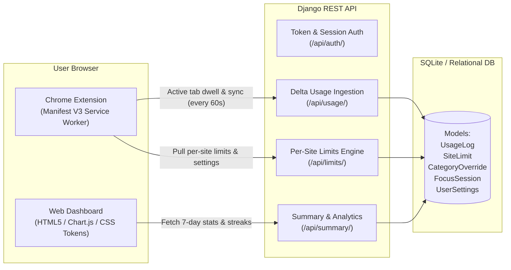

# Driftless — Digital Wellbeing & Distraction Tracker

> A modern, distraction-free digital wellbeing companion designed to help students, creators, and professionals understand their screen habits, protect deep focus, and maintain daily productivity streaks.

---

## 🎯 Architecture Diagram



---

## ✨ Key Features

1. **Unified Design System**: Single shared design-token system (`theme.css`) with synchronized color palettes, micro-interactions, and typography across the Chrome extension, dashboard, and login portal.
2. **Universal Productive Time Tracking**: Tracks both productive domains (GitHub, StackOverflow, LeetCode, docs, `.edu`) and distracting sites. Focus efficiency calculates strictly as `Productive / (Productive + Social + Entertainment)`.
3. **Per-Site Timers & 3-Tier Escalation Logic**:
   - **80% of limit**: Gentle Chrome notification nudge.
   - **100% of limit**: Alert notification warning that streak is at risk.
   - **100% + 5m grace period**: Automatic dynamic blocking via `declarativeNetRequest` redirecting to `blocked.html`.
4. **Persona Presets**: Student, Professional, Influencer, and Creator personas configure intelligent default limits (e.g. Influencers categorize Instagram/YouTube as work/productive).
5. **Category Overrides & Whitelists**: Manage domain categories and whitelist critical work portals from the dashboard settings.
6. **Focus Timer Blocks**: Preset focus sprints (25, 45, 60 minutes) in the popup with session logging and daily focus goal rings.
7. **Strict Privacy Architecture**: Only domains and seconds are stored. Driftless never accesses page content, passwords, or browsing history. Includes 1-click JSON Data Export and Data Erase.

---

## 🛠️ Technology Stack

- **Backend**: Python 3.10+, Django 4.2 LTS, Django REST Framework, django-cors-headers, WhiteNoise
- **Frontend**: Django Templates, Vanilla CSS Variables (`theme.css`), Tailwind CSS utility bridge, Chart.js 4.4
- **Chrome Extension**: Manifest V3 Service Worker, `chrome.declarativeNetRequest`, `chrome.storage.local`, `chrome.alarms`, `chrome.idle`
- **Database**: SQLite (local/dev & PythonAnywhere) / PostgreSQL ready

---

## 🚀 Getting Started

### 1. Clone & Set Up the Backend
```powershell
# Navigate to project root
cd c:\Users\AADI\Desktop\driftless\dashboard

# Activate virtual environment
.\venv\Scripts\Activate.ps1

# Run database migrations
python manage.py migrate

# Seed evaluator account with 14 days of realistic consistent history
python manage.py seed_demo

# Start the dev server
python manage.py runserver 0.0.0.0:8000
```

### 2. Evaluator Demo Account
- **Username / Email**: `demo@driftless.app` (or `demo`)
- **Password**: `demo123456`
- **Pre-loaded with**: 14 days of consistent usage data, a 14-day unbroken streak, and custom site limits.

### 3. Load the Chrome Extension
1. Open Google Chrome and go to `chrome://extensions`.
2. Toggle on **Developer mode** (top-right).
3. Click **Load unpacked** and select the `/extension` directory (or use `driftless-extension.zip`).
4. Click the Driftless extension icon in your toolbar, log in or paste your API token from the dashboard.

---

## 🧪 Running Automated Tests
```powershell
cd dashboard
python manage.py test
```
*Runs all unit and API tests validating data isolation, domain classification, and token authentication.*

---

## 📸 Screenshots & Previews

| Auth & Landing Portal | Analytics Dashboard | Chrome Extension Popup | Site Blocked Notice |
| :---: | :---: | :---: | :---: |
| Clean theme gradient & persona selector | Focus goal rings, bar/trend charts | Per-site timers & focus sprints | Streak-protective block page |
