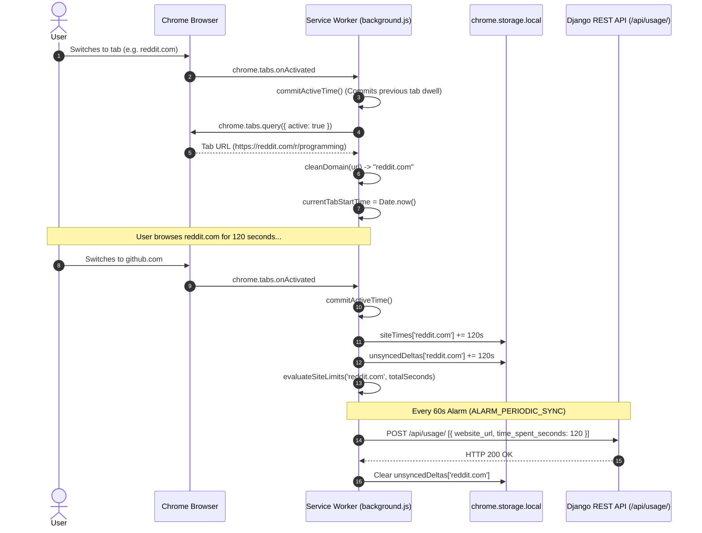
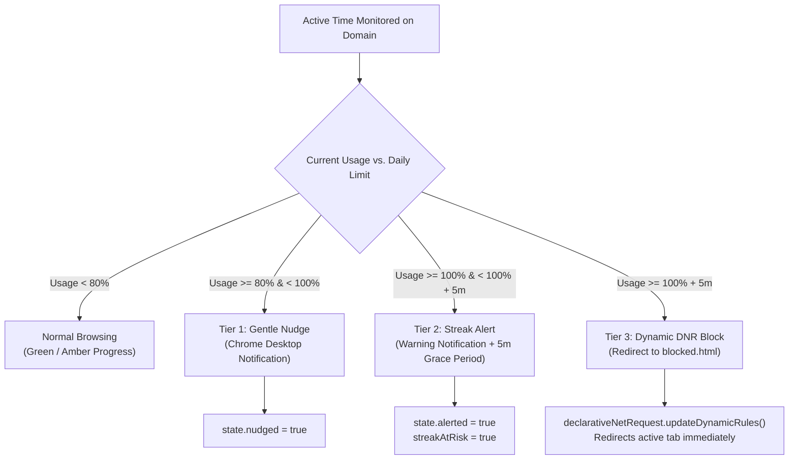

# DRIFTLESS — Chrome Extension Architecture & Execution Model

## 1. Overview & Architectural Role

The DRIFTLESS Chrome Extension is built strictly on **Chrome Manifest V3 (MV3)**. It operates as the client-side telemetry and enforcement agent of the system. Its responsibilities are:
1. **Passive Time Tracking:** Accurately measuring dwell time on active browser tabs without running invasive content scripts on user web pages.
2. **Escalation Enforcement:** Evaluating per-site daily limits against accumulated dwell time and executing a 3-tier escalation strategy (80% nudge, 100% alert, +5m DNR block).
3. **Focus Mode Blocking:** Dynamically redirecting distracting domains to `blocked.html` during dedicated sprint blocks.
4. **Cloud Synchronization:** Buffering local time deltas in `chrome.storage.local` and pushing them periodically to the Django REST API over authenticated HTTP endpoints.

---

## 2. Manifest V3 Configuration & Permissions

The extension is declared in `extension/manifest.json`:

```json
{
  "manifest_version": 3,
  "name": "Driftless - Focus & Wellbeing Companion",
  "version": "1.1",
  "permissions": [
    "tabs",
    "storage",
    "alarms",
    "notifications",
    "idle",
    "declarativeNetRequest",
    "declarativeNetRequestWithHostAccess",
    "declarativeNetRequestFeedback"
  ],
  "host_permissions": [
    "<all_urls>"
  ],
  "web_accessible_resources": [
    {
      "resources": ["blocked.html", "theme.css", "icons/*"],
      "matches": ["<all_urls>"]
    }
  ],
  "background": {
    "service_worker": "background.js"
  }
}
```

### Permission Justifications
- `tabs`: Required to listen to active tab switches (`tabs.onActivated`) and navigation commits (`tabs.onUpdated`), allowing extraction of the hostname for dwell tracking.
- `storage`: Enables non-volatile asynchronous key-value persistence via `chrome.storage.local` for tracking timers, cached server limits, and unsynced delta buffers.
- `alarms`: Essential in Manifest V3 to schedule background wake-ups without running continuous infinite loops. Drives the 60-second periodic sync and midnight reset.
- `notifications`: Allows displaying native system desktop notifications for 80% nudges, 100% streak risk alerts, and focus session completions.
- `idle`: Detects user inactivity (`chrome.idle.onStateChanged`), pausing time accumulation when the user steps away for > 60 seconds.
- `declarativeNetRequest`: Performs fast, privacy-preserving network-level redirects to `blocked.html` without executing JavaScript inside the target web page.
- `host_permissions: ["<all_urls>"]`: Permits declarative interception of any distracting domain matching the user's blocked list.

---

## 3. Service Worker Lifecycle & Tracking Algorithm

In Manifest V3, background scripts run as ephemeral service workers that can be suspended by Chrome after ~30 seconds of inactivity. To ensure high tracking accuracy without losing dwell time, `background.js` uses an event-driven accumulation pattern:



### 3.1. Tab Dwell Measurement Rules
Dwell time is accumulated **only** when all of the following conditions hold true:
1. `currentTabDomain` is a valid HTTP/HTTPS domain.
2. `currentTabStartTime` is a valid timestamp.
3. `isWindowFocused === true` (detected via `chrome.windows.onFocusChanged`).
4. `isUserActive === true` (state is `active` via `chrome.idle.onStateChanged`, interval 60s).

If the user minimizes Chrome, switches to another desktop application, locks their screen, or leaves the computer idle for over 60 seconds, `commitActiveTime()` runs immediately, commits the active duration up to that second, and pauses tracking until focus and user activity resume.

---

## 4. 3-Tier Escalation Logic & DNR Blocking

DRIFTLESS does not immediately lock users out of websites without warning. Instead, it enforces a gentle, 3-tier escalation ladder:



### Escalation Implementation Details
1. **Tier 1 — 80% Limit Nudge:**
   - Evaluated in `evaluateSiteLimits()`.
   - Triggers `sendNudgeNotification()` with message: `"You've used Xm of your Ym daily limit on <domain>."`
   - Sets `escalationState[domain].nudged = true` to prevent duplicate notifications.
2. **Tier 2 — 100% Limit Alert:**
   - Triggers `sendAlertNotification()` with message: `"Daily limit of Ym reached on <domain>! 5m grace period active before site is blocked."`
   - Sets `escalationState[domain].alerted = true` and `streakAtRisk = true`.
3. **Tier 3 — Dynamic Request Blocking:**
   - If user continues browsing past `limitSeconds + 300` (5 minutes grace period), `blockDomainViaDNR(domain)` executes.
   - Injects a dynamic redirect rule using `chrome.declarativeNetRequest.updateDynamicRules()`:
     ```javascript
     {
       id: newId,
       priority: 2,
       action: {
         type: 'redirect',
         redirect: { url: chrome.runtime.getURL(`blocked.html?site=${encodeURIComponent(domain)}`) }
       },
       condition: {
         urlFilter: `||${domain}`,
         resourceTypes: ['main_frame']
       }
     }
     ```
   - If the user is currently focused on the violating tab, `chrome.tabs.update(activeTab.id, { url: redirectUrl })` instantly redirects them to `blocked.html`.

---

## 5. Focus Mode & Discrete Focus Sprints

Focus Mode suppresses distractions on demand:
- **Default Distraction Filter:** `['instagram.com', 'youtube.com', 'reddit.com', 'x.com', 'twitter.com', 'tiktok.com', 'netflix.com']`, or the user's custom `blocked_sites` list.
- **Focus Sprints:** The user can initiate a 25, 45, or 60-minute focus sprint from the extension popup.
- **Sprint Lifecycle:**
  1. Popup sends `START_FOCUS_TIMER` message with `durationMinutes`.
  2. Service worker calls `enableFocusMode()`, installing DNR redirect rules with IDs `FOCUS_RULE_BASE_ID + i`.
  3. Service worker schedules `chrome.alarms.create(ALARM_FOCUS_TIMER_END, { delayInMinutes })`.
  4. When the alarm triggers, service worker calls `disableFocusMode()`, clears dynamic rules, notifies the user via desktop notification, and logs the completed session to the server via `POST /api/sessions/`.

---

## 6. Daily Reset & Offline Synchronization

### 6.1. Periodic Cloud Synchronization
- Runs every 60 seconds driven by `ALARM_PERIODIC_SYNC`.
- Sends uncommitted time deltas (`unsyncedDeltas`) to `POST /api/usage/`.
- If the computer is offline or the server is temporarily unreachable, deltas remain safely buffered in `chrome.storage.local` and are transmitted automatically upon reconnection.
- Following a successful usage push, calls `pullBackendConfig()` to retrieve updated `siteLimits` and `userSettings`.

### 6.2. Midnight Daily Reset
- Scheduled via `scheduleMidnightReset()` to fire at `00:00:00` local time.
- Commits remaining active seconds and performs a final sync to the server.
- Strips all dynamic limit block rules (`r.id >= LIMIT_BLOCK_RULE_BASE_ID`) from `declarativeNetRequest`.
- Resets `siteTimes = {}`, `unsyncedDeltas = {}`, `escalationState = {}`, and `streakAtRisk = false`.

---

## 7. Known Manifest V3 Constraints & Mitigations

| Manifest V3 Constraint | Technical Impact | Driftless Mitigation Architecture |
| :--- | :--- | :--- |
| **Service Worker Termination** | Inactive service workers terminate after ~30 seconds, losing in-memory global variables. | All persistent state is committed immediately to `chrome.storage.local`. In-memory variables (`currentTabStartTime`) are re-initialized on every browser event. |
| **No DOM Access in Service Workers** | Cannot read web page DOM, cookies, or window titles directly in `background.js`. | Driftless intentionally tracks only the bare hostname via `tab.url`, guaranteeing privacy by design and eliminating the need for DOM access. |
| **Alarm Minimum Interval** | In production, `chrome.alarms` cannot fire more frequently than once per minute. | 60-second granularity is ideal for digital wellbeing sync and prevents unnecessary server load. |
| **Browser Force Kill** | If Chrome is killed via Task Manager, uncommitted dwell seconds since the last tab event or 60s alarm could be lost. | Tab switches, window blur events, and idle state transitions trigger immediate commits, keeping uncommitted time under 60 seconds. |
