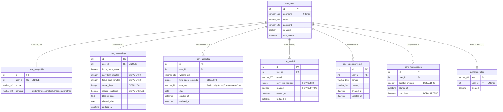

# DRIFTLESS — Database Schema & Data Flow Architecture

## 1. Database Overview & Migration History

DRIFTLESS utilizes **SQLite 3** as its primary persistence engine (`db.sqlite3`), supported natively by Django's database abstraction layer. 

### Applied Migrations (`dashboard/core/migrations/`):
- `0001_initial`: Created initial base models (`UsageLog`, `UserSettings`).
- `0002_usagelog_category_usersettings`: Added `category` column to `UsageLog` and expanded `UserSettings`.
- `0003_userprofile`: Created `UserProfile` model extending Django's auth `User` with phone and persona.
- `0004_alter_userprofile_persona`: Updated persona choices to support `student`, `professional`, `influencer`, `creator`, and `other`.
- `0005_usersettings_allowed_sites_and_more`: Added `SiteLimit`, `CategoryOverride`, `FocusSession`, unique constraints, and indexes.

---

## 2. Entity-Relationship (ER) Schema



---

## 3. Detailed Model Field Specifications

### 3.1. `core_usagelog`
- **Primary Key:** `id` (`BigAutoField`, Auto-increment).
- **Foreign Key:** `user_id` referencing `auth_user(id)` with `on_delete=CASCADE`.
- **Fields:**
  - `website_url` (`CharField(255)`): Sanitized domain name (e.g. `github.com`).
  - `time_spent_seconds` (`PositiveIntegerField`): Accumulated dwell time for that calendar date.
  - `category` (`CharField(20)`): Classification label (`Productivity`, `Social`, `Entertainment`, `Other`).
  - `date` (`DateField`): The specific calendar date of the dwell activity.
- **Constraints & Indexes:**
  - `unique_together = ('user', 'website_url', 'date')` guarantees that each website has at most one row per user per calendar day.
  - `Index(fields=['user', 'date'])` accelerates 7-day range scans for weekly summaries.

### 3.2. `core_sitelimit`
- **Unique Constraint:** `unique_together = ('user', 'domain')`.
- **Fields:**
  - `domain` (`CharField(255)`): Target sanitized hostname.
  - `daily_limit_minutes` (`PositiveIntegerField`, default `30`): Daily time cap in minutes.
  - `enabled` (`BooleanField`, default `True`): Toggles enforcement of the limit.

### 3.3. `core_categoryoverride`
- **Unique Constraint:** `unique_together = ('user', 'domain')`.
- **Fields:**
  - `domain` (`CharField(255)`): Overridden hostname.
  - `category` (`CharField(30)`): Target category choice.

---

## 4. End-to-End Data Flow (Browser Storage ↔ Backend Database)

```mermaid
sequenceDiagram
    autonumber
    participant ActiveTab as User Tab (e.g. youtube.com)
    participant SW as Service Worker (background.js)
    participant Storage as chrome.storage.local
    participant API as Django Ingestion (/api/usage/)
    participant DB as SQLite (UsageLog)
    participant SummaryAPI as Django Analytics (/api/summary/)
    participant Dashboard as Web Dashboard (dashboard.html)

    ActiveTab->>SW: Navigation & Active Dwell
    SW->>Storage: Increment siteTimes['youtube.com'] += 60s
    SW->>Storage: Increment unsyncedDeltas['youtube.com'] += 60s

    Note over SW,API: 60s Periodic Sync Alarm Triggered
    SW->>Storage: Read unsyncedDeltas
    SW->>API: POST /api/usage/ [{ website_url: "youtube.com", time_spent_seconds: 60, date: "2026-10-26" }]
    API->>DB: UsageLog.objects.get_or_create(user, "youtube.com", date)
    API->>DB: time_spent_seconds += 60, save()
    API-->>SW: HTTP 200 OK { created: 0, updated: 1 }
    SW->>Storage: unsyncedDeltas['youtube.com'] = 0

    Note over Dashboard,SummaryAPI: Dashboard Page Loaded or Auto-Refreshed
    Dashboard->>SummaryAPI: GET /api/summary/
    SummaryAPI->>DB: Query 7-day logs (UsageLog.objects.filter(date__gte=week_ago))
    SummaryAPI->>DB: Calculate strict streak & focus efficiency
    SummaryAPI-->>Dashboard: Return { weekly: [...], daily: [...], stats: {...} }
    Dashboard->>Dashboard: Chart.js updates canvas; KPI metrics rendered
```

---

## 5. Storage Partitioning: Browser Local vs. Backend Database

| Metric / Attribute | Browser-Local Storage (`chrome.storage.local`) | Backend Database (`db.sqlite3`) |
| :--- | :--- | :--- |
| **Storage Lifetime** | Resets daily at midnight; cleared if extension is uninstalled. | Permanent historical record across months and years. |
| **Tracking Granularity**| Sub-minute raw second increments (`siteTimes`). | Daily aggregated seconds (`UsageLog.time_spent_seconds`). |
| **Sync Buffer** | Unsent delta queue (`unsyncedDeltas`) buffered during offline intervals. | Clean committed state. |
| **Enforcement States** | 3-tier escalation flags (`escalationState[domain].nudged/alerted/blocked`). | `SiteLimit` rules and threshold configurations. |
| **Focus Mode State** | Dynamic DNR rule status (`focusModeActive`, `focusTimerEndTime`). | Persistent user preference flag (`UserSettings.focus_mode_active`). |
| **Authentication** | Bearer API token string (`apiToken`). | `authtoken_token` table linking token key to `auth_user`. |
