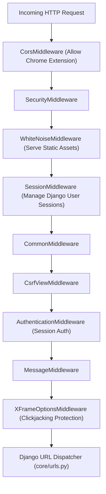
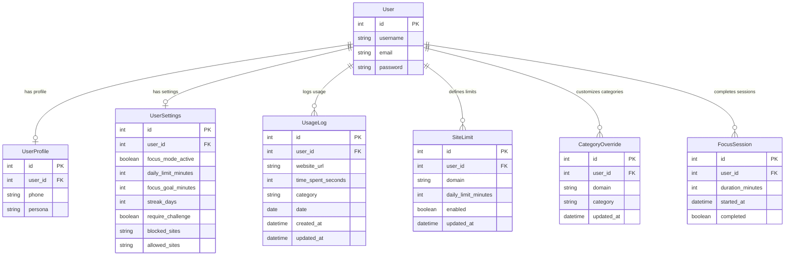
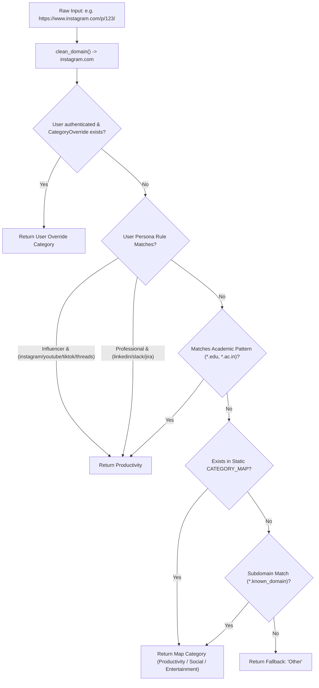

# DRIFTLESS — Django Backend Architecture & Business Logic

## 1. Overview of Backend Architecture

The backend of DRIFTLESS is built on **Python 3.10+** and **Django 4.2 LTS**, supplemented by **Django REST Framework (DRF 3.15)**. It serves two distinct client consumers:
1. **The Web Dashboard Client:** Consumes rendered HTML views, session authentication, and high-level analytical endpoints (`/api/summary/`, `/api/settings/`, `/api/limits/`).
2. **The Chrome Extension Client:** Consumes stateless Token Authentication (`TokenAuthentication`) endpoints to ingest usage deltas (`/api/usage/`), synchronize limits, and register focus sessions.

---

## 2. Django Configuration & Middleware Pipeline

Configured in `dashboard/driftless/settings.py`:



### Core Configuration Attributes:
- **Database Engine:** `django.db.backends.sqlite3` with database file stored at `BASE_DIR / 'db.sqlite3'`.
- **DRF Configuration:**
  - `DEFAULT_AUTHENTICATION_CLASSES`: `[TokenAuthentication, SessionAuthentication]`.
  - `DEFAULT_PERMISSION_CLASSES`: `[IsAuthenticated]`.
  - `DEFAULT_THROTTLE_CLASSES`: `AnonRateThrottle (100/day)`, `UserRateThrottle (1000/day)`.
  - Custom `SyncRateThrottle`: `120/min` configured on the `/api/usage/` endpoint.
- **CORS Configuration:** `CORS_ALLOWED_ORIGIN_REGEXES = [r'^chrome-extension://.*$']` and `CORS_ALLOW_CREDENTIALS = True`.

---

## 3. Data Models & Database Schema

The core models reside in `dashboard/core/models.py`:



### Model Specifications
1. **`UserProfile`:**
   - One-to-one relationship with `User`.
   - Stores optional normalized contact phone and active persona: `student`, `professional`, `influencer`, `creator`, `other`.
2. **`UsageLog`:**
   - Tracks accumulated dwell seconds per domain per date.
   - Enforces unique constraint on `('user', 'website_url', 'date')`.
   - Indexed on `['user', 'date']` for high-performance 7-day range queries.
3. **`SiteLimit`:**
   - Configures daily limit in minutes per domain.
   - Enforces unique constraint on `('user', 'domain')`.
4. **`CategoryOverride`:**
   - Allows user-specific re-categorization of any domain.
   - Saves clean domain and updates existing `UsageLog` records retroactively.
5. **`FocusSession`:**
   - Records discrete completed focus sprint intervals (25, 45, 60 minutes).
6. **`UserSettings`:**
   - Synchronizes persistent user preferences between web and browser extension.

---

## 4. Domain Classification Engine

Implemented in `classify_domain(domain: str, user=None) -> str`:



---

## 5. Major Backend Views & Business Logic Execution

### 5.1. Usage Ingestion: `usage_log_view`
- **Trigger:** Chrome extension 60-second periodic alarm (`ALARM_PERIODIC_SYNC`) or popup open.
- **Input:** JSON array `[{ "website_url": "github.com", "time_spent_seconds": 60, "date": "2026-10-26" }]`.
- **Processing:**
  1. Serializer validates non-negative seconds and clamps values `<= 86400`.
  2. For each entry, calculates category via `classify_domain(domain, user=request.user)`.
  3. Executes atomic `UsageLog.objects.get_or_create(user=request.user, website_url=domain, date=entry_date)`.
  4. Increments `obj.time_spent_seconds += entry['time_spent_seconds']`.
  5. Updates category and timestamp via `obj.save(update_fields=['time_spent_seconds', 'category', 'updated_at'])`.
- **Output:** `HTTP 200 OK` with `{ "created": <int>, "updated": <int> }`.
- **Dependent Component:** `extension/background.js` clears `unsyncedDeltas`.

---

### 5.2. Analytics Aggregation: `summary_view`
- **Trigger:** Web dashboard page load, tab focus, or extension popup open.
- **Input:** `GET /api/summary/` with user session or Token.
- **Processing:**
  1. Computes date range for the past 7 days (`week_ago` to `today`).
  2. Aggregates per-day, per-category sums using `.values('date', 'category').annotate(total_seconds=Sum('time_spent_seconds'))`.
  3. Zero-fills any missing days in the 7-day range to provide Chart.js with continuous daily metrics.
  4. Aggregates today's per-site usage descending by seconds.
  5. Computes **Focus Efficiency Metric:**
     $$\text{Focus Efficiency} = \text{round}\left(\frac{\text{Productive Seconds}}{\text{Productive} + \text{Social} + \text{Entertainment}} \times 100\right)$$
  6. Executes **Strict Streak Calculation Algorithm** (detailed below).
  7. Formats distractions list merging configured `SiteLimit` entries with today's actual usage.
  8. Appends today's completed focus sessions count and longest session.
- **Output:** Unified JSON payload containing `weekly`, `daily`, `stats`, `distractions`, `settings`, and `user`.
- **Dependent Component:** `dashboard.html` (`renderDashboard`) and `popup.js`.

---

### 5.3. Strict Streak Calculation Algorithm
DRIFTLESS enforces strict integrity on streak days. A day counts toward a user's streak **if and only if** no tracked domain exceeded its daily limit:
```python
# From dashboard/core/views.py (lines 294-347)
limits_dict = {
    l.domain: l.daily_limit_minutes * 60
    for l in SiteLimit.objects.filter(user=request.user, enabled=True)
}
global_limit_sec = settings_obj.daily_limit_minutes * 60

streak = 0
check_date = today - datetime.timedelta(days=1)

while True:
    day_logs = user_logs.filter(date=check_date)
    if not day_logs.exists():
        break  # Streak breaks if no logs exist for that past day

    day_failed = False
    for log in day_logs:
        site_limit = limits_dict.get(log.website_url, None)
        if site_limit is not None and log.time_spent_seconds > site_limit:
            day_failed = True
            break
        elif site_limit is None and log.category in (CATEGORY_SOCIAL, CATEGORY_ENTERTAINMENT):
            if log.time_spent_seconds > global_limit_sec:
                day_failed = True
                break

    if day_failed:
        break
    else:
        streak += 1
        check_date -= datetime.timedelta(days=1)

# Check today's status
if today_logs.exists() and not today_exceeded and today_total > 0:
    streak += 1
```

---

### 5.4. Category Override Management: `categories_list_create_view`
- **Trigger:** User creates or modifies a custom category in dashboard settings.
- **Input:** `POST /api/categories/` with `{ "domain": "reddit.com", "category": "Productivity" }`.
- **Processing:**
  1. Creates or updates `CategoryOverride` for `request.user`.
  2. Executes retroactive batch database update:
     ```python
     UsageLog.objects.filter(user=request.user, website_url=domain).update(category=category)
     ```
  3. Returns serialized override instance.
- **Output:** `HTTP 201 Created` or `HTTP 200 OK`.
- **Dependent Component:** Recalculates historical focus efficiency and 7-day charts instantly.

---

### 5.5. Privacy & Data Sovereignty: `data_export_view` & `data_delete_view`
- **Data Export (`GET /api/data/export/`):** Queries all `UsageLog`, `SiteLimit`, `CategoryOverride`, and `FocusSession` records for `request.user` and returns an indented JSON file.
- **Data Deletion (`POST /api/data/delete/`):** Invokes `.delete()` on `UsageLog.objects.filter(user=request.user)` and `FocusSession.objects.filter(user=request.user)`, purging history while preserving the user account and settings.
