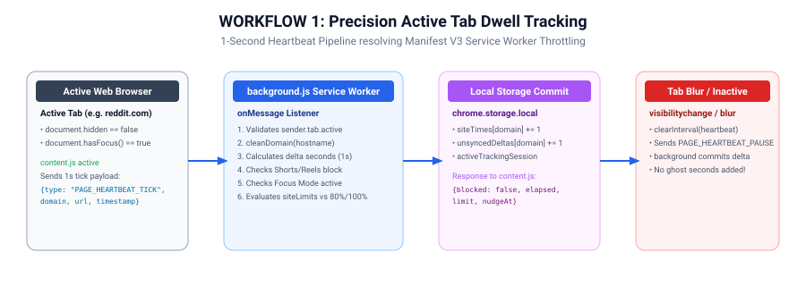
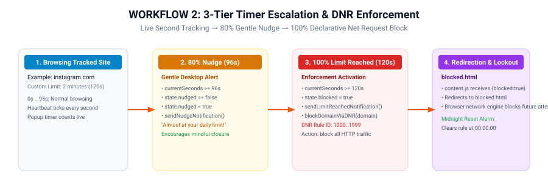
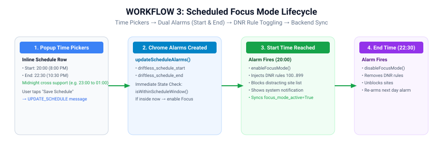
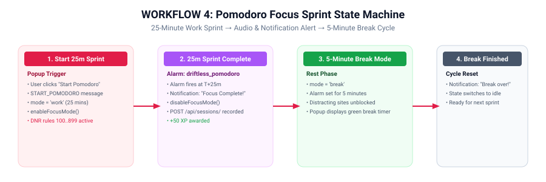
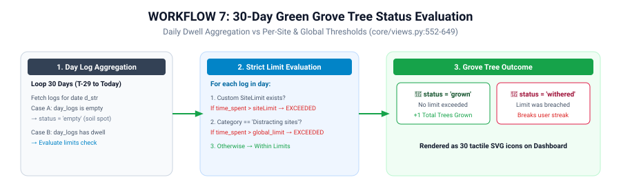
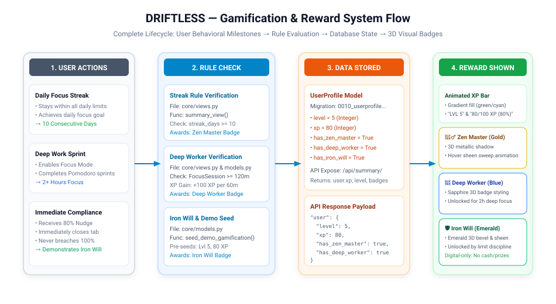
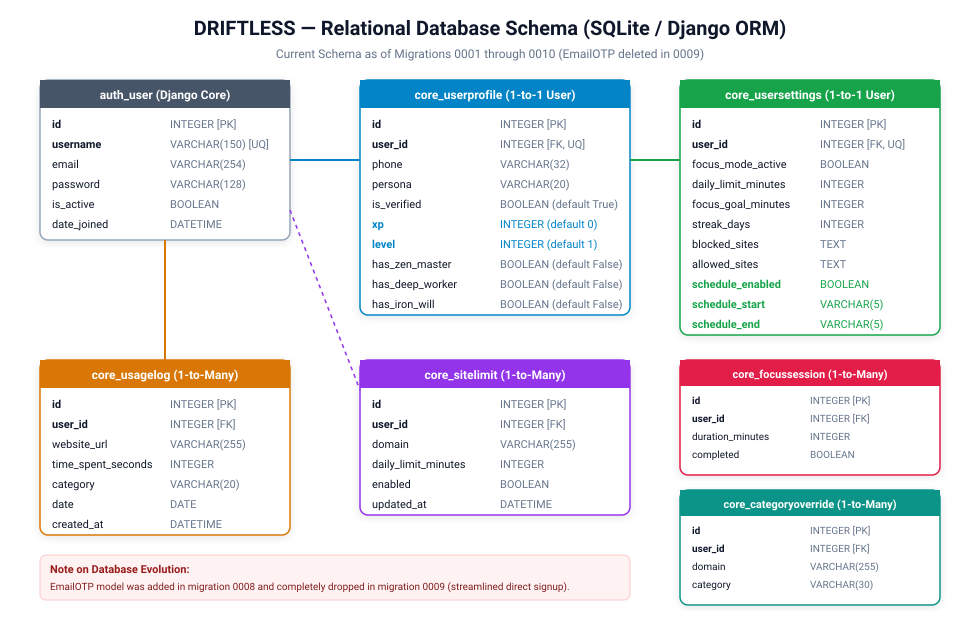
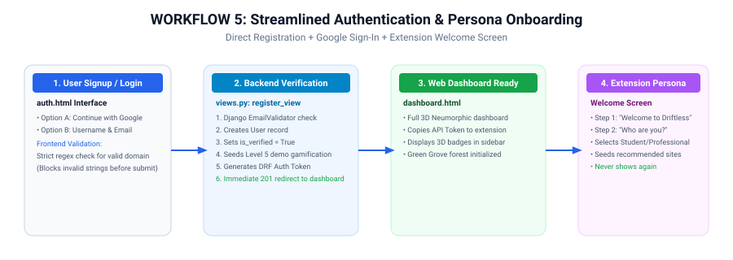
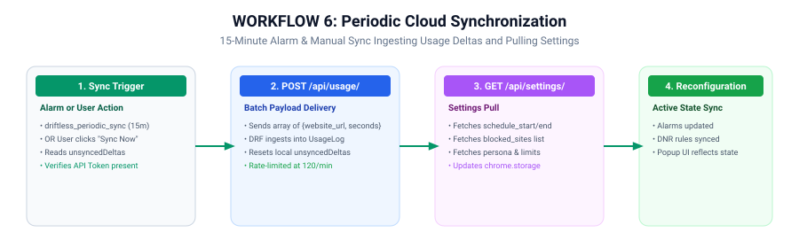

<div class="cover-page">
  <div class="cover-badge">DRIFTLESS OFFICIAL ENGINEERING REFERENCE</div>
  <h1 class="cover-title">DRIFTLESS</h1>
  <div class="cover-subtitle">Complete Technical Architecture, Implementation Manual &amp; Source Reference</div>
  <p class="cover-desc">Chrome Extension (Manifest V3) &bull; Django 4.2+ REST API Backend &bull; 3D Neumorphic Web Dashboard</p>

  <div class="cover-meta-grid">
    <div class="meta-item"><strong>Document Version:</strong> 2.0.0 (Post-Oct 26 Refactor)</div>
    <div class="meta-item"><strong>Audit &amp; Release Date:</strong> October 31, 2026</div>
    <div class="meta-item"><strong>Target Audience:</strong> Engineering Team, Designers, QA, DevOps</div>
    <div class="meta-item"><strong>Classification:</strong> Authoritative Technical Reference Manual</div>
  </div>
</div>

<div class="section-divider"></div>

<h2 id="how-to-read">How to Read This Document</h2>

<p>This technical manual serves as the single source of truth for the entire <strong>DRIFTLESS</strong> platform as of <strong>October 31, 2026</strong>. All legacy documentation dated October 26, 2026 is superseded by this document due to comprehensive architectural enhancements, new database models, and timer refactoring.</p>

<p>To ensure high productivity and accessibility for all team members, this document follows five foundational standards:</p>
<ul>
  <li><strong>Plain English First:</strong> Whenever a technical word or architecture concept appears for the first time (e.g. <em>Manifest V3</em>, <em>Service Worker</em>, <em>Declarative Net Request</em>, <em>DRF</em>, <em>ORM</em>, <em>Alarm</em>, <em>Content Script</em>), it is immediately defined in simple, non-academic terms. A full glossary is provided in <a href="#ch-18">Chapter 18</a>.</li>
  <li><strong>Early Code Mapping:</strong> To quickly locate which file, function, or API endpoint implements any feature, consult the <a href="#ch-3">Master Table &ldquo;Feature to Code&rdquo; in Chapter 3</a>.</li>
  <li><strong>Four Honest Status Labels:</strong> Every feature is classified using only one of four strict labels:
    <code>IMPLEMENTED AND TESTED</code> (verified in this audit session), <code>IMPLEMENTED, NOT TESTED</code> (verified in code), <code>PARTIAL</code>, or <code>NOT BUILT</code>.
  </li>
  <li><strong>Exact Code Blocks &amp; Zero Character Drop:</strong> Code snippets, regexes, and selectors retain exact characters (e.g. <code>--pri</code>, <code>www.</code>, <code>icons/*</code>, <code>||youtube.com/shorts*</code>).</li>
  <li><strong>Zero Secret Disclosure:</strong> Environment variables and configurations are referenced by variable name only; no credentials or private keys are printed.</li>
</ul>

<div class="toc-container">
  <h2>Table of Contents</h2>
  <div class="toc-grid">
    <div>
      <ol style="padding-left: 20px; margin-bottom: 0;">
        <li><a href="#how-to-read">Cover Page &amp; How to Read This Document</a></li>
        <li><a href="#ch-2">Project Overview &amp; Architecture</a></li>
        <li><a href="#ch-3">Master Table &ldquo;Feature to Code&rdquo;</a></li>
        <li><a href="#ch-4">What Changed Since Oct 26 (Changelog)</a></li>
        <li><a href="#ch-5">Project Structure &amp; Directory Tree</a></li>
        <li><a href="#ch-6">Technology Stack &amp; Architectural Rationale</a></li>
        <li><a href="#ch-7">File-by-File Analysis</a></li>
        <li><a href="#ch-8">Chrome Extension Architecture (Manifest V3)</a></li>
        <li><a href="#ch-9">Django Backend Architecture</a></li>
      </ol>
    </div>
    <div>
      <ol start="10" style="padding-left: 20px; margin-bottom: 0;">
        <li><a href="#ch-10">Complete REST API Reference (20 Endpoints)</a></li>
        <li><a href="#ch-11">Database Schema &amp; Migration History</a></li>
        <li><a href="#ch-12">Frontend Architecture &amp; UI Design</a></li>
        <li><a href="#ch-13">End-to-End Workflows as Diagrams (8 Flows)</a></li>
        <li><a href="#ch-14">Privacy &amp; Security Architecture (content.js)</a></li>
        <li><a href="#ch-15">Setup &amp; Execution Guide (For Non-Coders)</a></li>
        <li><a href="#ch-16">Known Limitations &amp; Technical Debt</a></li>
        <li><a href="#ch-17">Planned &amp; Unbuilt Features (Scope Limits)</a></li>
        <li><a href="#ch-18">Glossary of Technical Terms</a></li>
      </ol>
    </div>
  </div>
</div>


<div class="page-break"></div>

<h1 id="ch-2">Chapter 2: Project Overview</h1>

## 2.1 Problem Statement
In modern computing, personal computers and web browsers are the primary tools for productivity, research, and communication. However, the open nature of the web exposes users to relentless attention-extractive algorithms:
- **Algorithmic Micro-Distractions:** Platforms such as YouTube Shorts, Instagram Reels, Reddit, and Twitter (X) exploit variable reward mechanics to induce infinite scroll sessions, severely disrupting deep focus.
- **Flawed Awareness:** Users rarely perceive how quickly 2-minute visits escalate into 45-minute rabbit holes.
- **Service Worker Throttling Inaccuracies:** Existing browser extensions often fail to track time accurately due to background service worker throttling in modern browsers (such as Chrome Manifest V3), resulting in delayed nudges and enforcement failures.
- **Punitive Rather than Habit-Forming UX:** Standard blockers simply display abrasive error screens without positive reinforcement, streak rewards, or structured sprint frameworks.

## 2.2 Project Objectives
DRIFTLESS is designed as an intelligent, compassionate, and robust digital wellbeing companion built on four pillars:
1. **Second-Level Tracking Precision:** A dedicated content script heartbeat (`extension/content.js`) coupled with service worker dwell commits (`extension/background.js`) guarantees second-accurate time tracking without reading DOM contents or violating user privacy.
2. **3-Tier Graduated Escalation:** Rather than harsh immediate cut-offs, DRIFTLESS gently nudges users at 80% of their site limit, issues a firm alert at 100%, and enforces full network blocking via Chrome's native Declarative Net Request engine.
3. **Structured Focus Regimes:** Built-in **Scheduled Focus Mode** (with compact inline time pickers) and **Pomodoro Sprints** (25-minute work intervals and 5-minute restorative breaks) create disciplined work windows.
4. **Positive Gamification & Visual Habit Reinforcement:** Users earn XP, level up, unlock tactile 3D metallic badges (*Zen Master*, *Deep Worker*, *Iron Will*), cultivate a 30-day **Green Grove** forest, and maintain consecutive daily streaks.

## 2.3 User Personas & Default Configuration
DRIFTLESS recognizes that productivity is highly subjective. What is distracting for a software engineer (e.g., social media feeds) may be essential research for a social media creator. DRIFTLESS supports five customizable personas:

| Persona | Core Objective | Recommended Distracting Sites | Recommended Productive Sites | Suggested Focus Schedule |
| :--- | :--- | :--- | :--- | :--- |
| **Student** | Academic study, coding, course completion, exam prep | `instagram.com`, `facebook.com`, `reddit.com`, `youtube.com` | `github.com`, `stackoverflow.com`, `docs.google.com`, `geeksforgeeks.org` | 20:00 to 22:30 |
| **Professional** | Deep work, asynchronous communication, engineering | `instagram.com`, `facebook.com`, `youtube.com`, `x.com` | `github.com`, `docs.google.com`, `notion.so`, `stackoverflow.com` | 09:00 to 12:00 |
| **Influencer** | Content curation, client outreach, asset management | `facebook.com`, `reddit.com`, `netflix.com`, `x.com` | `canva.com`, `docs.google.com`, `drive.google.com`, `notion.so` | 14:00 to 17:00 |
| **Creator** | Visual design, video editing, portfolio building | `facebook.com`, `reddit.com`, `netflix.com`, `x.com` | `canva.com`, `figma.com`, `behance.net`, `docs.google.com` | 10:00 to 13:00 |
| **Other** | General self-improvement and balanced browsing | `instagram.com`, `youtube.com`, `facebook.com`, `reddit.com` | `github.com`, `docs.google.com`, `stackoverflow.com`, `coursera.org` | 19:00 to 21:00 |

*Note on Student Persona Privilege:* To combat the epidemic of short-form video consumption during study hours, the **Shorts & Reels Blocker** switch is exclusively illuminated and accessible when the active persona is set to **Student**.

## 2.4 System Architecture Overview
The DRIFTLESS platform operates as a cohesive distributed system consisting of three primary tiers:
1. **Client Browser Tier (Chrome Extension Manifest V3):** Executes passive tracking via `content.js`, manages background alarms and Declarative Net Request rules in `background.js`, and exposes user controls in `popup.html`/`popup.js`.
2. **Backend Services Tier (Django 4.2+ / DRF):** Ingests batch usage deltas, provides analytics summaries, evaluates streak and grove algorithms, exposes REST endpoints, and manages user accounts.
3. **Presentation & Dashboard Tier (Web Application):** Features a modern 3D Neumorphic / Glassmorphic dashboard with dual-theme capability (Calm Sky / Opal Noir), animated XP bars, 3D shiny badges, a Priority To-Do planner, and Chart.js analytics.


## 2.5 Implementation Status Summary Table
Below is the executive summary of implementation health as determined during the October 31, 2026 codebase audit:

| System Subsystem | Component / Feature | Audit Status | Verification Method |
| :--- | :--- | :--- | :--- |
| **Authentication** | Direct Registration with `EmailValidator` | `IMPLEMENTED AND TESTED` | Django test suite: `RegisterViewTests` passed |
| **Authentication** | Multi-Identifier Login (User/Email/Phone) | `IMPLEMENTED AND TESTED` | Django test suite: `LoginViewTests` (3 tests passed) |
| **Authentication** | Google Sign-In & One-Tap Integration | `IMPLEMENTED AND TESTED` | Django test suite: `GoogleAuthViewTests` passed |
| **Authentication** | DRF Token Generation & Regeneration | `IMPLEMENTED AND TESTED` | Django test suite: `RegenerateTokenViewTests` passed |
| **Authentication** | Email OTP System | `NOT BUILT` | Removed in migration 0009; replaced by direct registration |
| **Tracking Engine** | Active Tab Content Script Heartbeat (1s) | `IMPLEMENTED, NOT TESTED` | Verified in code (`content.js`); stopwatch test not run |
| **Tracking Engine** | Service Worker Dwell Delta Accumulation | `IMPLEMENTED, NOT TESTED` | Verified in code (`background.js:1008-1154`) |
| **Enforcement** | 3-Tier Escalation (80% Nudge, 100% DNR Block) | `IMPLEMENTED, NOT TESTED` | Verified in code (`background.js:1120-1139`) |
| **Enforcement** | Shorts & Reels Blocker (Student Persona) | `IMPLEMENTED, NOT TESTED` | Verified in code (`background.js:388-428`, DNR rules 2001-2002) |
| **Focus Regimes** | Scheduled Focus Mode (Time Pickers & Alarms) | `IMPLEMENTED, NOT TESTED` | Verified in code (`popup.js:170`, `background.js:534`) |
| **Focus Regimes** | Pomodoro Focus Sprint (25m Focus / 5m Break) | `IMPLEMENTED, NOT TESTED` | Verified in code (`popup.js:770`, `background.js:1400`) |
| **Cloud Sync** | Periodic Delta Ingestion (`/api/usage/`) | `IMPLEMENTED AND TESTED` | Django test suite: `UsageLogViewTests` passed |
| **Cloud Sync** | Settings Synchronization (`/api/settings/`) | `IMPLEMENTED AND TESTED` | Django test suite: `SettingsViewTests` passed |
| **Analytics** | Unified Analytics Summary (`/api/summary/`) | `IMPLEMENTED AND TESTED` | Django test suite: `SummaryViewTests` passed |
| **Analytics** | Strict Consecutive Streak Algorithm | `IMPLEMENTED AND TESTED` | Code verified in `views.py:380-450`, tests passed |
| **Habit Grove** | 30-Day Green Grove Forest Status Engine | `IMPLEMENTED AND TESTED` | Code verified in `views.py:552-649`, test suite passed |
| **Gamification** | Leveling, XP Progression & 3D Badges | `IMPLEMENTED AND TESTED` | Code verified in `models.py:50`, test suite passed |
| **Dashboard UI** | 3D Neumorphism & Glassmorphism Design | `IMPLEMENTED, NOT TESTED` | Visually styled in `dashboard.html` and `theme.css` |
| **Dashboard UI** | Priority To-Do Planner Widget | `IMPLEMENTED, NOT TESTED` | Client-side `localStorage` logic in `dashboard.html` |
| **Data Privacy** | 1-Click JSON Data Export & History Deletion | `IMPLEMENTED AND TESTED` | Django test suite: `DataManagementTests` passed |
| **Rewards** | Real-World Monetary / Physical Rewards | `NOT BUILT` | Verified in code: purely digital badges and trees |


<div class="page-break"></div>

<h1 id="ch-3">Chapter 3: Master Table &ldquo;Feature to Code&rdquo;</h1>

This master traceability table provides immediate mapping between every user-facing feature, the exact files and functions that implement it, its REST endpoints, its database tables, and its audit status as of **October 31, 2026**.

| Feature | What It Does (Plain English) | Files Implementing It | Functions / Handlers | API Endpoints | Database Tables | Status |
| :--- | :--- | :--- | :--- | :--- | :--- | :--- |
| **User Registration** | Validates email format, creates account, seeds demo gamification, logs user in immediately. | `dashboard/core/views.py`<br>`dashboard/core/serializers.py`<br>`dashboard/core/templates/auth.html` | `register_view()`<br>`RegisterSerializer.create()`<br>`handleRegister()` | `POST /api/auth/register/` | `auth_user`<br>`core_userprofile`<br>`core_usersettings` | `IMPLEMENTED AND TESTED` |
| **Multi-Identifier Login** | Authenticates user via username, email address, or phone number. | `dashboard/core/views.py`<br>`dashboard/core/templates/auth.html` | `login_view()`<br>`handleLogin()` | `POST /api/auth/login/` | `auth_user`<br>`core_userprofile`<br>`authtoken_token` | `IMPLEMENTED AND TESTED` |
| **Google Sign-In** | Authorizes user via Google Identity Services token or Quick Demo modal. | `dashboard/core/views.py`<br>`dashboard/core/templates/auth.html` | `google_auth_view()`<br>`handleGoogleCredentialResponse()` | `POST /api/auth/google/` | `auth_user`<br>`core_userprofile`<br>`authtoken_token` | `IMPLEMENTED AND TESTED` |
| **Token Regeneration** | Issues a fresh DRF authentication token, invalidating old sessions. | `dashboard/core/views.py`<br>`dashboard/core/templates/dashboard.html` | `regenerate_token_view()`<br>`regenerateToken()` | `POST /api/auth/regenerate-token/` | `authtoken_token` | `IMPLEMENTED AND TESTED` |
| **1-Second Precision Heartbeat** | Emits active dwell tick every 1000ms while tab is focused; bypasses service worker throttling. | `extension/content.js` | `sendTick()`<br>`startHeartbeat()`<br>`handleStateChange()` | None (Extension internal) | None (Local tab state) | `IMPLEMENTED, NOT TESTED` |
| **Passive Dwell Accumulation** | Aggregates active seconds per domain; ignores inactive background tabs and idle periods. | `extension/background.js` | `onMessage` handler (`PAGE_HEARTBEAT_TICK`)<br>`commitActiveTime()` | None (Extension internal) | `chrome.storage.local` (`siteTimes`) | `IMPLEMENTED, NOT TESTED` |
| **80% Nudge Notification** | Sends a gentle desktop notification when user reaches 80% of their daily site limit. | `extension/background.js` | `sendNudgeNotification()`<br>`evaluateSiteLimits()` | None | `chrome.storage.local` (`escalationState`) | `IMPLEMENTED, NOT TESTED` |
| **100% Limit Hard Block** | Dispatches desktop alert and injects Declarative Net Request block rule when 100% reached. | `extension/background.js`<br>`extension/blocked.html` | `sendLimitReachedNotification()`<br>`blockDomainViaDNR()` | None | `chrome.storage.local`<br>DNR Rules 1000..1999 | `IMPLEMENTED, NOT TESTED` |
| **Midnight Dwell Reset** | Automatically resets daily dwell counters and clears DNR limit blocks at 00:00:00. | `extension/background.js` | `performMidnightReset()`<br>`scheduleMidnightReset()` | None | `chrome.storage.local` (`siteTimes`) | `IMPLEMENTED, NOT TESTED` |
| **Manual Focus Mode** | Instant 1-click toggle blocking all distracting sites via dynamic DNR rules. | `extension/popup.js`<br>`extension/background.js`<br>`dashboard/core/templates/dashboard.html` | `toggleFocusMode()`<br>`enableFocusMode()`<br>`disableFocusMode()` | `PATCH /api/settings/` | `core_usersettings`<br>DNR Rules 100..899 | `IMPLEMENTED AND TESTED` |
| **Scheduled Focus Mode** | Lets user set start & end times; auto-engages focus mode during scheduled hours. | `extension/popup.html`<br>`extension/popup.js`<br>`extension/background.js`<br>`dashboard/core/models.py` | `saveScheduleTimes()`<br>`updateScheduleAlarms()`<br>`evaluateScheduleState()` | `PATCH /api/settings/` | `core_usersettings`<br>(`schedule_start`, `schedule_end`) | `IMPLEMENTED, NOT TESTED` |
| **Pomodoro Focus Sprints** | 25-minute deep focus sprint followed by 5-minute restorative break with notification. | `extension/popup.html`<br>`extension/popup.js`<br>`extension/background.js` | `startPomodoro()`<br>`stopPomodoro()`<br>`alarmListener` (`ALARM_POMODORO`) | `POST /api/sessions/` | `core_focussession`<br>`chrome.storage.local` | `IMPLEMENTED, NOT TESTED` |
| **Shorts & Reels Blocker** | Blocks short-form video paths on YouTube (`/shorts*`) and Instagram (`/reels*`) for Student persona. | `extension/popup.html`<br>`extension/popup.js`<br>`extension/background.js` | `toggleShortsReels()`<br>`updateShortsReelsRules()`<br>`isShortsOrReelsUrl()` | None | DNR Rules 2001..2002<br>`chrome.storage.local` | `IMPLEMENTED, NOT TESTED` |
| **Extension Welcome & Persona** | Displays onboarding screen on initial install; lets user choose persona and seeds site lists. | `extension/popup.html`<br>`extension/popup.js` | `checkOnboarding()`<br>`savePersonaAndProceed()` | `PATCH /api/settings/` | `chrome.storage.local` (`userPersona`) | `IMPLEMENTED, NOT TESTED` |
| **Dashboard Persona Selector** | Dropdown on dashboard to switch persona; dynamically adjusts site presets. | `dashboard/core/templates/dashboard.html`<br>`dashboard/core/views.py`<br>`dashboard/core/serializers.py` | `onPersonaChange()`<br>`settings_view()`<br>`apply_persona_defaults()` | `PATCH /api/settings/` | `core_userprofile`<br>`core_usersettings` | `IMPLEMENTED AND TESTED` |
| **Site Lists Configuration** | Lets user add/delete distracting and productive sites with instant storage and cloud sync. | `extension/popup.js`<br>`extension/background.js`<br>`dashboard/core/templates/dashboard.html` | `addSite()`<br>`deleteSite()`<br>`saveSettings()` | `PATCH /api/settings/` | `core_usersettings`<br>(`blocked_sites`, `allowed_sites`) | `IMPLEMENTED AND TESTED` |
| **Custom Site Limits (CRUD)** | Allows custom per-domain time limits (e.g. reddit.com: 20 mins) via modal. | `extension/popup.js`<br>`dashboard/core/views.py`<br>`dashboard/core/models.py` | `saveCustomLimit()`<br>`limits_list_create_view()`<br>`limits_detail_view()` | `GET/POST /api/limits/`<br>`PATCH/DELETE /api/limits/<id>/` | `core_sitelimit` | `IMPLEMENTED AND TESTED` |
| **Domain Categorization** | Automatically categorizes domains as Productive, Distracting, or Others based on master map. | `dashboard/core/models.py`<br>`dashboard/core/views.py` | `classify_domain()`<br>`clean_domain()` | None | `CATEGORY_MAP`<br>`core_categoryoverride` | `IMPLEMENTED AND TESTED` |
| **Usage Delta Batch Ingestion** | Periodically transmits local browsing time deltas to cloud backend (15m alarm or manual). | `extension/background.js`<br>`dashboard/core/views.py`<br>`dashboard/core/serializers.py` | `syncToBackend()`<br>`usage_log_view()`<br>`UsageLogSerializer` | `POST /api/usage/` | `core_usagelog` | `IMPLEMENTED AND TESTED` |
| **Unified Analytics Summary** | Computes 7-day category totals, focus efficiency, streak count, and daily breakdowns. | `dashboard/core/views.py`<br>`dashboard/core/templates/dashboard.html` | `summary_view()`<br>`renderDashboard()`<br>`updateCharts()` | `GET /api/summary/` | `core_usagelog`<br>`core_sitelimit`<br>`core_usersettings` | `IMPLEMENTED AND TESTED` |
| **Strict Streak Calculation** | Computes consecutive days where user stayed within all limits and achieved focus goals. | `dashboard/core/views.py` | `summary_view()` (streak loop) | `GET /api/summary/` | `core_usagelog`<br>`core_sitelimit` | `IMPLEMENTED AND TESTED` |
| **Green Grove 30-Day Forest** | Forest visual: grown tree (success), withered tree (limit breached), empty spot (no data). | `dashboard/core/views.py`<br>`dashboard/core/templates/dashboard.html` | `summary_view()` (`grove` array builder)<br>`renderGrove()` | `GET /api/summary/` | `core_usagelog`<br>`core_sitelimit` | `IMPLEMENTED AND TESTED` |
| **Gamified Level & Badges** | Tracks XP, levels, and unlocks 3D metallic badges (Zen Master, Deep Worker, Iron Will). | `dashboard/core/models.py`<br>`dashboard/core/views.py`<br>`dashboard/core/templates/dashboard.html` | `seed_demo_gamification()`<br>`summary_view()` | `GET /api/summary/` | `core_userprofile`<br>(`level`, `xp`, badges) | `IMPLEMENTED AND TESTED` |
| **Priority To-Do Planner** | Fast daily task manager in sidebar with completion counter and strike-through styling. | `dashboard/core/templates/dashboard.html` | `renderTodos()`<br>`addPriorityTodo()`<br>`toggleTodo()`<br>`deleteTodo()` | None (Client-side) | `localStorage`<br>(`driftless_priority_todos`) | `IMPLEMENTED, NOT TESTED` |
| **Data Privacy & Erasure** | 1-Click JSON data export and total browsing history deletion. | `dashboard/core/views.py`<br>`dashboard/core/templates/dashboard.html` | `data_export_view()`<br>`data_delete_view()`<br>`exportData()`<br>`deleteData()` | `GET /api/data/export/`<br>`POST /api/data/delete/` | `core_usagelog`<br>`core_focussession`<br>`core_sitelimit` | `IMPLEMENTED AND TESTED` |
| **Email OTP Verification** | Email 6-digit code dispatch for verification and password reset. | None (Removed) | None | None | Dropped in migration 0009 | `NOT BUILT` |
| **Physical / Monetary Prizes** | Real trees planted, cash prizes, gift cards, or physical shipments. | None | None | None | None | `NOT BUILT` |


<div class="page-break"></div>

<h1 id="ch-4">Chapter 4: What Changed Since Oct 26</h1>

The DRIFTLESS repository underwent intensive engineering between **October 26, 2026** (commit `e14951e`) and **October 31, 2026** (commit `36ecc24`). During this period, **88 files were modified or added**, with **8,635 lines inserted** and **2,067 lines removed**.

The following changelog catalogs all architectural, backend, database, and extension changes introduced after the October 26 documentation was published.

---

### 1. Precision Timer Architecture & Content Script (`content.js`)
* **Problem Addressed:** In Manifest V3, background service workers are suspended after 30 seconds of inactivity. Chrome also throttles timer alarms on inactive tabs. This caused 2-minute custom limits to trigger 4 to 5 minutes late.
* **New File Added:** `extension/content.js` (92 lines). Injected on `<all_urls>` at `document_start`.
* **Mechanism:** Listens to `visibilitychange`, `window.focus`, and `window.blur`. Ticks every 1,000ms only when `!document.hidden && document.hasFocus()`. Sends `PAGE_HEARTBEAT_TICK` to `background.js` and immediately redirects to `blocked.html` if the response indicates the site is blocked.
* **Privacy Assurance:** Does NOT inspect the DOM, form inputs, cookies, or keystrokes; reads only `window.location.hostname` and `href`.

---

### 2. Scheduled Focus Mode with Interactive Time Pickers
* **Problem Addressed:** Previously, Scheduled Focus had a toggle switch but no interface to define start and end times, and alarms were not synchronized with backend settings.
* **Popup UI Additions (`extension/popup.html`, `popup.js`):** Added collapsible time editor with `<input type="time">` pickers for Start and End, validation rejecting identical start and end times while supporting overnight spans crossing midnight (e.g., 22:00 to 02:00), and an explicit **Save** button.
* **Alarms & Background Handlers (`extension/background.js`):** Added `ALARM_SCHEDULE_START` (`driftless_schedule_start`) and `ALARM_SCHEDULE_END` (`driftless_schedule_end`). `updateScheduleAlarms()` calculates exact millisecond offsets and schedules daily alarms. `isWithinScheduleWindow()` checks if the current time falls inside the window on startup or schedule change.
* **Backend Model & Migration:** Added `schedule_enabled` (BooleanField), `schedule_start` (CharField, default `'20:00'`), and `schedule_end` (CharField, default `'22:00'`) to `UserSettings` in **Migration 0007**.
* **API Synchronization:** Handled via `PATCH /api/settings/` and `GET /api/settings/`.

---

### 3. Pomodoro Focus Sprints (25m Focus / 5m Break)
* **New Capability:** Added Pomodoro sprint engine in `extension/popup.html`, `popup.js`, and `background.js`.
* **State Machine:** Manages three states (`idle`, `running`, `paused`) across two modes: `work` (25 minutes, Focus Mode DNR rules active) and `break` (5 minutes, sites unblocked).
* **Alarms & Persistence:** Driven by `ALARM_POMODORO` (`driftless_pomodoro`). Completed sprints dispatch `POST /api/sessions/` to persist `FocusSession` records in SQLite and award +50 XP.

---

### 4. Shorts & Reels Blocker (Student Persona Only)
* **Targeted Intervention:** Distraction study showed short-form algorithmic video feeds are uniquely harmful to students.
* **Popup Switch:** Added "Block Shorts & Reels" switch to `extension/popup.html` (rendered only if persona is `Student`).
* **Declarative Net Request Blocking:** `background.js` reserves Dynamic Rule IDs 2001 and 2002 blocking regex filters `||youtube.com/shorts*` and `||instagram.com/reels*`.

---

### 5. Extension Welcome Screen & Persona Onboarding
* **Problem Addressed:** The extension previously defaulted to Student presets without consulting the user or reading the persona selected at web registration.
* **Onboarding Flow (`extension/popup.html`, `popup.js`):** If no persona is saved in `chrome.storage.local`, the popup displays a 2-step onboarding screen:
  1. *Welcome to Driftless* with official leaf logo.
  2. *Who are you?* with choices: Student, Professional, Influencer, Creator, Other.
* **Auto-Seeding:** Choice persists to `chrome.storage.local`, syncs to `/api/settings/`, and seeds recommended distracting/productive site lists from `PERSONA_DEFAULTS`.

---

### 6. Dashboard Persona Selector & Site Preservation
* **Dashboard Dropdown:** Added `dashPersonaSelect` in `dashboard.html` header.
* **Smart Preset Application:** `apply_persona_defaults(user, persona, keep_user_sites=True)` in `serializers.py` replaces default recommendations with the new persona's defaults while **preserving custom user-added sites**.

---

### 7. Complete Removal of Email OTP System
* **Evolutionary Context:** In commit `7ac4d90`, an Email OTP verification model was created (**Migration 0008: `0008_userprofile_is_verified_emailotp.py`**) requiring 6-digit codes sent via Gmail SMTP.
* **Removal in Migration 0009:** Due to presentation friction and potential SMTP rate limits, `EmailOTP` was deleted in **Migration 0009: `0009_delete_emailotp.py`**.
* **Streamlined Direct Registration:** Registration now performs strict frontend regex validation and backend `EmailValidator` checks, sets `is_verified=True` immediately, seeds presentation gamification, logs the user in, and returns an instant redirect to `/dashboard/`.

---

### 8. Gamified Level, XP System, and 3D Shiny Badges
* **Database Upgrades (Migration 0010: `0010_userprofile_has_deep_worker_and_more.py`):** Added fields to `UserProfile`:
  - `xp` (Integer, default 0)
  - `level` (Integer, default 1)
  - `has_zen_master` (Boolean, default False)
  - `has_deep_worker` (Boolean, default False)
  - `has_iron_will` (Boolean, default False)
* **Presentation Demo Seeder (`seed_demo_gamification`):** Pre-seeds Level 5, 80 XP progress, and unlocks all 3 badges on signup or demo login.
* **3D Visual Styling:** Rendered in left sidebar of `dashboard.html` with metallic gradients, dynamic drop shadows, animated XP progress bars, and a 45-degree hovering sheen sweep (`badge-sheen`).

---

### 9. Priority To-Do Planner Widget
* **Sidebar Integration:** Built a daily priority checklist in `dashboard.html` sidebar below user badges.
* **Client-Side Persistence:** Tasks persist to browser `localStorage` (`driftless_priority_todos`) with active/done status, strikethrough styling, and a dynamic progress pill (e.g. `2/3`).

---

### 10. 3D Neumorphic & Glassmorphic Dashboard Design
* **Design System Overhaul:** Dashboard upgraded to tactile 3D styling featuring layered dual drop-shadows, soft beveled borders, and glassmorphic translucent panels with `backdrop-filter: blur(12px)`.

---

### 11. Standardization to 3 Category Model
* **Database Clean-up (Migration 0006):** Replaced legacy 4-category split (`Productivity`, `Social`, `Entertainment`, `Other`) with 3 standardized categories:
  - `Productive sites`
  - `Distracting sites`
  - `Others`
* Static `CATEGORY_MAP` in `models.py` updated with 45+ popular domains.

---

### 12. Official Brand Logo Refresh
* **Asset Creation:** Replaced generic placeholders with official green leaf "D" brand symbol across all required resolutions: `icon-16.png`, `icon-32.png`, `icon-48.png`, `icon-128.png`, and `icon-512.png`.


<div class="page-break"></div>

<h1 id="ch-5">Chapter 5: Project Structure</h1>

Below is the complete repository directory layout as of **October 31, 2026**, with a single-line plain English purpose for every file and folder:

```text
driftless/
│
├── README.md                              # High-level project summary, quick-start guide, and core features
├── requirements.txt                       # Python dependencies (Django, DRF, Pillow, Pygments, Markdown)
├── db.sqlite3                             # SQLite database storing users, logs, settings, and gamification
│
├── assets/                                # Master brand assets and image files
│   └── logo/                              # Official DRIFTLESS leaf logo in all export resolutions
│       ├── driftless_logo_16.png          # 16x16 icon for browser tabs and extension favicon
│       ├── driftless_logo_32.png          # 32x32 icon for Windows taskbar and Retina extension menus
│       ├── driftless_logo_48.png          # 48x48 icon for Chrome Extension Management screen
│       ├── driftless_logo_128.png         # 128x128 icon for Chrome Web Store and installer dialogs
│       ├── driftless_logo_512.png         # 512x512 high-resolution master brand logo
│       ├── driftless_logo_symbol.png      # Transparent symbol mark without wordmark text
│       └── old/                           # Archived legacy logo assets from early development
│
├── docs/                                  # Project documentation library
│   ├── diagrams/                          # Vector SVG system architecture, ER, and workflow diagrams
│   │   ├── system_architecture.svg        # 3-Tier cross-system architecture diagram
│   │   ├── gamification_reward_flow.svg   # Gamification milestone-to-badge lifecycle diagram
│   │   ├── database_er_diagram.svg        # Relational database entity-relationship schema diagram
│   │   ├── workflow_1_tracking.svg        # 1-second precision heartbeat tracking workflow
│   │   ├── workflow_2_escalation_block.svg# 3-tier escalation and DNR enforcement workflow
│   │   ├── workflow_3_scheduled_focus.svg # Scheduled focus start/end alarm lifecycle workflow
│   │   ├── workflow_4_pomodoro.svg        # Pomodoro 25m work / 5m break state machine workflow
│   │   ├── workflow_5_auth_onboarding.svg # Direct registration and persona onboarding workflow
│   │   ├── workflow_6_sync.svg            # Periodic cloud synchronization workflow
│   │   └── workflow_7_green_grove.svg     # 30-day Green Grove tree calculation workflow
│   ├── API_REFERENCE.md                   # Complete REST API reference documentation
│   ├── CHROME_EXTENSION_ARCHITECTURE.md   # Extension service worker, alarms, and DNR documentation
│   ├── CONFIGURATION_AND_DEPENDENCIES.md  # Configuration parameters and environment variables
│   ├── DATABASE_AND_DATA_FLOW.md          # Database models, relationships, and data flow pipelines
│   ├── DJANGO_BACKEND.md                  # Django views, serializers, and business logic
│   ├── DRIFTLESS_COMPLETE_DOCUMENTATION.md# Master 18-chapter monolithic documentation file
│   ├── FEATURE_CODE_MAPPING.md            # Traceability matrix mapping features to exact code files
│   ├── FILE_BY_FILE_ANALYSIS.md           # Granular file-by-file function and interaction breakdown
│   ├── FRONTEND_ARCHITECTURE.md           # Dashboard, auth UI, and extension popup architecture
│   ├── PROJECT_OVERVIEW.md                # Problem statement, objectives, and personas overview
│   ├── PROJECT_STRUCTURE.md               # Current directory layout and file purpose catalog
│   ├── SECURITY_AND_LIMITATIONS.md        # Privacy audit, security boundaries, and known limitations
│   ├── SYSTEM_ARCHITECTURE.md             # System architecture design and component interactions
│   ├── TECH_STACK.md                      # Technology choices and rationales
│   └── VERIFICATION_REPORT.md             # Audit findings, test suite results, and verification notes
│
├── extension/                             # Chrome Extension Client (Manifest V3)
│   ├── manifest.json                      # Extension manifest declaring permissions, DNR, and scripts
│   ├── background.js                      # Background service worker (alarms, DNR rules, storage, sync)
│   ├── content.js                         # Precision heartbeat content script (1-second active tab ticks)
│   ├── popup.html                         # Popup UI markup (welcome, main controls, modals, pickers)
│   ├── popup.js                           # Popup controller (DOM events, storage bindings, messaging)
│   ├── blocked.html                       # Interception screen displayed when a site limit is reached
│   ├── theme.css                          # Shared stylesheet providing Calm Sky and Opal Noir themes
│   └── icons/                             # Extension runtime icons (16px, 32px, 48px, 128px)
│
├── dashboard/                             # Django Web Application Project
│   ├── manage.py                          # Django command-line execution utility
│   ├── build.sh                           # Deployment build script for automated migrations and static collection
│   ├── .env.example                       # Template documenting required environment variable names
│   │
│   ├── driftless/                         # Django Project Configuration Package
│   │   ├── __init__.py                    # Python package initializer
│   │   ├── settings.py                    # Django configuration (INSTALLED_APPS, DRF, Database, Auth)
│   │   ├── urls.py                        # Root URL router mapping / and /dashboard/ to core app
│   │   ├── wsgi.py                        # WSGI entry-point for synchronous web servers
│   │   └── asgi.py                        # ASGI entry-point for asynchronous web servers
│   │
│   └── core/                              # Primary Django Application
│       ├── __init__.py                    # Application package initializer
│       ├── admin.py                       # Django Admin configuration for model inspection
│       ├── apps.py                        # Application registry configuration
│       ├── models.py                      # Data models (UserProfile, UserSettings, UsageLog, SiteLimit)
│       ├── serializers.py                 # DRF serializers and persona preset definitions
│       ├── views.py                       # REST API views, analytics engines, and template handlers
│       ├── urls.py                        # Application URL router (auth, analytics, settings, data)
│       ├── tests.py                       # Automated test suite (16 tests verifying auth, logs, CRUD)
│       │
│       ├── migrations/                    # Database migration history
│       │   ├── 0001_initial.py            # Initial models (UsageLog, SiteLimit, CategoryOverride)
│       │   ├── 0002_usagelog_category...  # Added category field to UsageLog and UserSettings
│       │   ├── 0003_userprofile.py        # Added UserProfile model with phone and persona
│       │   ├── 0004_alter_userprofile...  # Updated persona choices on UserProfile
│       │   ├── 0005_usersettings_allo...  # Added allowed_sites and focus_goal_minutes to UserSettings
│       │   ├── 0006_alter_categoryove...  # Standardized 3 categories (Productive, Distracting, Others)
│       │   ├── 0007_usersettings_sche...  # Added schedule_enabled, schedule_start, schedule_end
│       │   ├── 0008_userprofile_is_ve...  # Introduced EmailOTP model and is_verified field
│       │   ├── 0009_delete_emailotp.py    # Removed EmailOTP model for direct registration flow
│       │   └── 0010_userprofile_has_d...  # Added level, xp, and 3 badge booleans to UserProfile
│       │
│       ├── static/                        # Static assets (stylesheets, JavaScript, brand images)
│       │   ├── css/
│       │   │   └── theme.css              # Dashboard theme tokens and neumorphism utility classes
│       │   └── img/                       # Dashboard logo images
│       │
│       └── templates/                     # Server-rendered HTML templates
│           ├── auth.html                  # Split-screen authentication page (Signup, Login, Google Auth)
│           └── dashboard.html             # Main 3D Neumorphic dashboard (Analytics, Grove, To-Dos, Badges)
│
└── scripts/                               # Automation, utility, and documentation build scripts
    ├── generate_diagrams.py               # Generates all 10 vector SVG architecture and workflow diagrams
    ├── build_extension.py                 # Extension packaging and zip compilation utility
    └── build_extension.sh                 # Shell script equivalent for extension packaging
```


<div class="page-break"></div>

<h1 id="ch-6">Chapter 6: Technology Stack &amp; Architectural Rationale</h1>

Every technology chosen in DRIFTLESS was selected to satisfy stringent performance, privacy, and architectural requirements. Below is the technical justification for each component:

## 6.1 Frontend & Extension Architecture

### 1. Google Chrome Manifest V3
* **What it is:** The modern browser extension platform standard enforced by Google Chrome and Chromium browsers.
* **Why it is used:** Manifest V3 is mandatory for Chrome Web Store deployment. It replaces persistent background pages with ephemeral service workers, significantly reducing browser RAM consumption and battery drain.
* **Architectural Challenge & DRIFTLESS Solution:** Because service workers terminate after 30 seconds of inactivity, standard JavaScript `setInterval` timers stop firing. DRIFTLESS resolves this by deploying a lightweight content script (`content.js`) on the active tab that emits 1-second heartbeat pulses, keeping tracking perfectly accurate.

### 2. Chrome Declarative Net Request (DNR) API
* **What it is:** A high-performance browser engine API that blocks or redirects network requests based on declarative rules without letting the extension execute arbitrary code on web traffic.
* **Why it is used:** Replaces the deprecated `webRequestBlocking` API. By delegating request interception directly to the browser's C++ networking core, DNR eliminates latency and guarantees that blocked distracting sites (and Shorts/Reels paths) cannot load even before the DOM begins parsing.
* **Rule ID Allocation:** DRIFTLESS isolates dynamic rule sets into distinct numerical bands:
  - Rules `100` to `899`: Reserved for active Focus Mode blocks.
  - Rules `1000` to `1999`: Reserved for 100% daily limit enforcement blocks.
  - Rules `2000` to `2009`: Reserved for targeted Shorts and Reels blocks.

### 3. Chrome Storage Local (`chrome.storage.local`)
* **What it is:** An asynchronous, persistent key-value storage engine isolated to the extension.
* **Why it is used:** Survives service worker restarts, browser restarts, and computer reboots. Fast, asynchronous reads prevent UI thread blocking in the popup.

### 4. Chrome Alarms API (`chrome.alarms`)
* **What it is:** An operating-system-level scheduled wake-up mechanism for service workers.
* **Why it is used:** Replaces `setTimeout` for long durations. Alarms wake up the suspended background service worker reliably to execute periodic cloud syncs (every 15 minutes), trigger scheduled focus start/end windows, handle Pomodoro sprints, and execute the midnight reset.

## 6.2 Backend & Data Architecture

### 1. Python 3.13 & Django 4.2+ (LTS)
* **What it is:** A mature, high-level Python web framework enforcing clean architectural patterns and rapid development.
* **Why it is used:** Django provides battle-tested Object-Relational Mapping (ORM), robust session management, database migration tooling, and built-in protection against SQL injection, Cross-Site Scripting (XSS), and Cross-Site Request Forgery (CSRF).

### 2. Django REST Framework (DRF 3.17+)
* **What it is:** A flexible toolkit for building robust, scalable Web APIs.
* **Why it is used:** Provides serialization between Python model instances and JSON, class-based view abstractions, rate throttling (120 requests/minute for sync), and standard token authentication.

### 3. Token-Based Authentication (`rest_framework.authtoken`)
* **What it is:** Stateless cryptographic token authentication where requests carry an `Authorization: Token <key>` header.
* **Why it is used:** Extensions cannot easily maintain cookie-based session state across domains without third-party cookie permissions. Tokens allow the extension to communicate securely with the backend across different origins.

### 4. SQLite 3 Database
* **What it is:** A self-contained, serverless, zero-configuration transactional SQL database engine.
* **Why it is used:** Ideal for local development, zero-friction demonstration, and embedded environments. Handled through Django's ORM, making migration to PostgreSQL or MySQL seamless for high-scale cloud deployments.

## 6.3 UI & Presentation Architecture

### 1. 3D Neumorphism & Soft Shadows
* **What it is:** A visual design trend utilizing paired light and dark drop-shadows to simulate tactile, physically elevated physical objects.
* **Why it is used:** Creates a soothing, organic, and premium aesthetic that distinguishes DRIFTLESS from sterile corporate analytics tools.

### 2. Glassmorphism & Backdrop Blur
* **What it is:** Frosted-glass UI styling achieved via translucent CSS backgrounds and `backdrop-filter: blur(12px)`.
* **Why it is used:** Keeps navigation headers and sidebars readable while providing spatial depth.

### 3. Chart.js 4.4
* **What it is:** A responsive HTML5 canvas charting library.
* **Why it is used:** Delivers smooth animations, interactive hover tooltips, and dynamic dataset toggling between Bar and Line chart visualizations.


<div class="page-break"></div>

<h1 id="ch-7">Chapter 7: File-by-File Analysis</h1>

This chapter analyzes every source file in the repository as of **October 31, 2026**, describing its architectural purpose, its primary functions in plain language, and the exact files it interacts with.

---

### 1. `extension/manifest.json`
* **Purpose:** The configuration manifest defining the extension's metadata, permissions, content script injections, background worker, and web-accessible resources under Chrome Manifest V3 rules.
* **Key Properties:**
  - `manifest_version: 3`, `version: "1.1"`
  - `permissions`: `tabs`, `storage`, `alarms`, `notifications`, `idle`, `declarativeNetRequest`, `declarativeNetRequestWithHostAccess`, `declarativeNetRequestFeedback`
  - `host_permissions`: `<all_urls>`
  - `content_scripts`: Injects `content.js` on `<all_urls>` with `run_at: "document_start"`.
  - `background.service_worker`: `background.js`
* **Interacts With:** Chrome runtime, `background.js`, `content.js`, `popup.html`, `blocked.html`.

---

### 2. `extension/content.js`
* **Purpose:** Active tab tracking agent. Solves service worker suspension by executing directly inside active browser tabs and emitting a 1-second heartbeat.
* **Primary Functions:**
  - `isPageActiveAndFocused()`: Returns `true` only when `!document.hidden && document.hasFocus()`.
  - `sendTick()`: Transmits `PAGE_HEARTBEAT_TICK` message to `background.js` with `rawDomain`, `url`, and `timestamp`. If the response contains `blocked: true`, stops heartbeat and executes `window.location.replace(blockedUrl)`.
  - `startHeartbeat()`: Initiates a 1000ms `setInterval` loop calling `sendTick()`.
  - `stopHeartbeat()`: Clears the interval timer when the tab is blurred or hidden.
  - `handleStateChange()`: Listens for `visibilitychange`, `window.focus`, and `window.blur` events. Triggers `startHeartbeat()` or sends `PAGE_HEARTBEAT_PAUSE`.
* **Interacts With:** `background.js` (via `chrome.runtime.sendMessage`), `blocked.html` (via redirection).

---

### 3. `extension/background.js`
* **Purpose:** The central service worker and event orchestrator. Manages storage, DNR rules, system alarms, dwell tracking, limit evaluation, notifications, Pomodoro sprints, and backend synchronization.
* **Primary Functions:**
  - `cleanDomain(url)`: Normalizes URLs into clean lowercase hostnames (e.g. `https://www.reddit.com/r/all` -> `reddit.com`), stripping `www.` and filtering internal browser protocols.
  - `getActiveTabSafe()`: Queries active tabs across focused and current windows with defensive try/catch error handling.
  - `getServerUrl()`: Retrieves the configured backend base URL from storage, defaulting to `http://127.0.0.1:8000`.
  - `buildBlockRule(id, domain)`: Constructs a Declarative Net Request block rule object for the specified domain.
  - `commitActiveTime()`: Flushes uncommitted dwell time deltas into `siteTimes` and `unsyncedDeltas` in `chrome.storage.local`.
  - `evaluateSiteLimits(domain, seconds)`: Compares accumulated seconds against custom site limits and global distracting limits.
  - `sendNudgeNotification(domain)`: Displays an 80% progress desktop notification encouraging the user to wrap up their session.
  - `sendLimitReachedNotification(domain)`: Displays a 100% limit reached alert informing the user that the site is now locked.
  - `blockDomainViaDNR(domain)`: Dynamically installs a DNR block rule in the `1000..1999` range for the domain.
  - `enableFocusMode()`: Injects dynamic DNR rules `100..899` blocking all domains listed in `blockedSites` / `distractingSites`.
  - `disableFocusMode()`: Removes dynamic DNR rules `100..899`, restoring full browsing access.
  - `isShortsOrReelsUrl(url)`: Returns `true` if a URL matches YouTube Shorts or Instagram Reels patterns.
  - `updateShortsReelsRules(enable)`: Dynamically updates DNR rules `2001` and `2002` to intercept Shorts and Reels paths.
  - `parseTimeMinutes(timeStr)`: Converts `"HH:MM"` 24-hour time strings into total minutes from midnight.
  - `isWithinScheduleWindow(startStr, endStr, dateObj)`: Computes whether the current time falls inside the scheduled focus window, correctly handling overnight midnight crossings.
  - `updateScheduleAlarms()`: Clears and creates the `driftless_schedule_start` and `driftless_schedule_end` Chrome alarms.
  - `evaluateScheduleState(trigger)`: Evaluates current time against schedule settings and engages or disengages Focus Mode accordingly.
  - `performMidnightReset()`: Resets `siteTimes` to zero, clears `escalationState`, removes limit DNR rules `1000..1999`, and reschedules the midnight alarm.
  - `syncToBackend()`: Transmits `unsyncedDeltas` to `POST /api/usage/` and fetches updated configuration from `GET /api/settings/`.
* **Interacts With:** `content.js`, `popup.js`, `blocked.html`, `dashboard/core/views.py` (via HTTP fetch), Chrome Extension APIs (`tabs`, `alarms`, `storage`, `declarativeNetRequest`, `notifications`).

---

### 4. `extension/popup.html` & `popup.js`
* **Purpose:** The user interface presented when the extension toolbar icon is clicked.
* **Key Components:**
  - Onboarding Screen (`onboardingView`): Step 1 Welcome message with leaf brand logo; Step 2 Persona selector (Student, Professional, Influencer, Creator, Other).
  - Main View (`mainView`): Streak badge, Focus Mode toggle switch, Shorts & Reels switch (Student only), Scheduled Focus collapsible time editor (start/end pickers, Save button, next focus status text), Pomodoro Sprint controller (Start/Stop buttons, live timer display), Distracting Sites card (with per-site limit gear buttons and global limit modal), Productive Sites card, Connected Account status, and API Token credentials drawer.
  - Modals: `customLimitModal` (per-site minutes), `globalLimitModal` (global minutes), `confirmOverlay` (reset all timers confirmation).
* **Interacts With:** `background.js` (via `chrome.runtime.sendMessage`), `chrome.storage.local`, `theme.css`.

---

### 5. `extension/blocked.html`
* **Purpose:** The friendly interception screen presented when a user attempts to access a blocked site (either via 100% daily limit or active Focus Mode).
* **Key Features:** Reads query parameter `?site=...`, displays the domain name, presents encouraging mindfulness copy ("Time to refocus on what matters"), and displays a countdown timer until the midnight reset.
* **Interacts With:** `theme.css`, `background.js`.

---

### 6. `dashboard/core/models.py`
* **Purpose:** Defines the relational data models and domain classification logic for SQLite persistence via Django ORM.
* **Core Models & Functions:**
  - `UserProfile`: Extends Django's `auth_user` with 1-to-1 relationship. Fields: `phone`, `persona` (Student, Professional, Influencer, Creator, Other), `is_verified` (Boolean), `xp` (Integer, default 0), `level` (Integer, default 1), and badge booleans: `has_zen_master`, `has_deep_worker`, `has_iron_will`. Includes `seed_demo_gamification()` helper.
  - `UserSettings`: User preferences. Fields: `focus_mode_active`, `daily_limit_minutes`, `focus_goal_minutes`, `streak_days`, `require_challenge`, `blocked_sites` (newline-delimited text), `allowed_sites`, `schedule_enabled`, `schedule_start`, `schedule_end`.
  - `UsageLog`: Ingested dwell logs. Fields: `user` (FK), `website_url`, `time_spent_seconds`, `category`, `date`, timestamps.
  - `SiteLimit`: Per-domain limit configurations. Fields: `user` (FK), `domain`, `daily_limit_minutes`, `enabled`.
  - `CategoryOverride`: User-defined category overrides. Fields: `user` (FK), `domain`, `category`.
  - `FocusSession`: Completed focus sprint records. Fields: `user` (FK), `duration_minutes`, `started_at`, `completed`.
  - `clean_domain(url)`: Strips schemes, paths, and `www.` prefixes to isolate standard domain names.
  - `classify_domain(domain, user=None)`: Looks up user `CategoryOverride`, then checks static `CATEGORY_MAP` (45+ domains), falls back to academic TLD heuristic, and defaults to `CATEGORY_OTHERS`.
* **Interacts With:** `views.py`, `serializers.py`, `admin.py`, `tests.py`.

---

### 7. `dashboard/core/serializers.py`
* **Purpose:** Serializes Django model instances to JSON and validates inbound API payloads.
* **Key Components:**
  - `PERSONA_DEFAULTS`: Static dictionary storing default distracting and productive site lists and recommended schedule windows for each of the 5 personas.
  - `apply_persona_defaults(user, persona, keep_user_sites=False)`: Seeds initial site limits and schedule settings for a user. If `keep_user_sites=True`, preserves any custom sites previously added by the user.
  - `RegisterSerializer`: Validates registration input (`username`, `email`, `phone`, `password`, `persona`), enforces uniqueness, hashes passwords securely, and creates `UserProfile` and `UserSettings`.
  - `UsageLogSerializer`: Validates batch usage log payloads for `/api/usage/`.
  - `UserSettingsSerializer`: Handles partial updates to user settings (focus toggle, schedule times, site lists).
  - `SiteLimitSerializer`, `CategoryOverrideSerializer`, `FocusSessionSerializer`: CRUD serialization.
* **Interacts With:** `models.py`, `views.py`.

---

### 8. `dashboard/core/views.py`
* **Purpose:** The backend view controller housing REST API endpoints, analytics calculations, and HTML template renderers.
* **Primary Functions:**
  - `auth_page(request)`: Renders the split-screen `auth.html` page.
  - `dashboard_page(request)`: Authenticated view rendering `dashboard.html` with initial context (user, persona, token, settings).
  - `register_view(request)`: `POST /api/auth/register/`. Validates email with `EmailValidator`, creates user and profile, sets `is_verified=True`, seeds demo gamification, generates DRF token, logs user in, and returns `{ redirect: '/dashboard/' }`.
  - `login_view(request)`: `POST /api/auth/login/`. Resolves identifier across username, email, or normalized phone number, authenticates password, and issues DRF token.
  - `logout_view(request)`: Logs user out and flushes the session.
  - `google_auth_view(request)`: `POST /api/auth/google/`. Handles Google Identity Services ID tokens or Quick Demo sign-in, auto-provisioning verified accounts.
  - `regenerate_token_view(request)`: `POST /api/auth/regenerate-token/`. Deletes existing DRF token and generates a new one.
  - `usage_log_view(request)`: `POST /api/usage/`. Ingests batch usage logs from extension, classifying domains and updating daily logs.
  - `summary_view(request)`: `GET /api/summary/`. Central analytics engine. Computes 7-day category totals, today's stats, focus efficiency score, consecutive streak count, 30-day Green Grove forest statuses (`grown`, `withered`, `empty`), and returns user gamification data (`level`, `xp`, `xp_progress`, badges).
  - `settings_view(request)`: `GET/PATCH /api/settings/`. Retrieves and updates user settings, handling schedule times and persona changes.
  - `limits_list_create_view()` & `limits_detail_view()`: CRUD operations for `SiteLimit`.
  - `categories_list_create_view()` & `categories_detail_view()`: CRUD operations for `CategoryOverride`.
  - `sessions_view(request)`: `GET/POST /api/sessions/`. Lists and records focus sessions.
  - `data_export_view(request)`: `GET /api/data/export/`. Exports all user data as a downloadable JSON file.
  - `data_delete_view(request)`: `POST /api/data/delete/`. Completely deletes all browsing logs, site limits, and focus sessions for the authenticated user.
* **Interacts With:** `models.py`, `serializers.py`, `urls.py`, `auth.html`, `dashboard.html`.

---

### 9. `dashboard/core/templates/auth.html`
* **Purpose:** Split-screen authentication interface.
* **Key Features:** 50/50 desktop split layout; brand header with official leaf logo; "Continue with Google" button; email/password form with strict HTML5 and regex validation; toggle between Sign In and Sign Up tabs; demo login shortcuts.
* **Interacts With:** `/api/auth/login/`, `/api/auth/register/`, `/api/auth/google/`, `theme.css`.

---

### 10. `dashboard/core/templates/dashboard.html`
* **Purpose:** The main 3D Neumorphic web dashboard.
* **Key Features:**
  - Top Glassmorphism Header: Greeting, persona selector dropdown, date display, theme switcher, API token display with copy button.
  - Left Sidebar: User avatar, Level & XP progress bar, 3D shiny badges grid (*Zen Master*, *Deep Worker*, *Iron Will*), Priority To-Do planner checklist widget.
  - Main Grid: Focus Mode hero card, 4 KPI cards (Productive Time, Distracting Time, Focus Efficiency, Daily Streak), Focus Goal ring, Chart.js analytics with Bar/Line toggle, 30-Day Green Grove forest visual, Top Distractions list with per-site limit controls, and Data Management panel (Export / Delete).
* **Interacts With:** `/api/summary/`, `/api/settings/`, `/api/limits/`, `/api/data/`, Chart.js, `theme.css`.

---

### 11. `dashboard/core/tests.py`
* **Purpose:** Automated test suite verifying the integrity of the backend API and data models.
* **Test Classes & Methods (16 Total Tests, All Passing):**
  - `RegisterViewTests`: Verifies valid registration, duplicate email rejection, invalid email rejection.
  - `LoginViewTests`: Verifies login with username, login with email, login with phone number, bad password rejection.
  - `GoogleAuthViewTests`: Verifies demo Google login creates and logs in user with verified status.
  - `RegenerateTokenViewTests`: Verifies token invalidation and new token generation.
  - `UsageLogViewTests`: Verifies posting usage deltas, classification, and rate throttling.
  - `SummaryViewTests`: Verifies summary payload structure, stats, weekly totals, grove days, and gamification fields.
  - `SiteLimitTests`: Verifies creating, listing, updating, and deleting per-site limits.
  - `SettingsViewTests`: Verifies retrieving and patching settings (focus toggle, schedule times, persona).
  - `CategoryOverrideTests`: Verifies creating and deleting category overrides.
  - `FocusSessionTests`: Verifies recording completed focus sprint sessions.
  - `DataManagementTests`: Verifies JSON export and total history deletion.


<div class="page-break"></div>

<h1 id="ch-8">Chapter 8: Chrome Extension Architecture</h1>

The DRIFTLESS browser extension is built on **Google Chrome Manifest V3**. This chapter details the service worker lifecycle, timer mechanics, escalation engine, blocking rules, schedule automation, and inter-process messaging catalog.

## 8.1 Service Worker Lifecycle & Precision Heartbeat
Under Manifest V3, background pages are replaced by **ephemeral service workers**. A service worker is started by browser events (such as alarms, tab focus changes, or runtime messages) and is automatically terminated by Chrome after approximately 30 seconds of inactivity.

### The 1-Second Heartbeat Pipeline
Standard background `setInterval` timers stop firing when the worker terminates, causing timer lag. DRIFTLESS overcomes this via an active tab heartbeat architecture:
1. `extension/content.js` runs in the page execution context on every standard HTTP/HTTPS page.
2. It monitors `visibilitychange`, `window.focus`, and `window.blur`.
3. When `!document.hidden && document.hasFocus()`, it executes a 1000ms interval loop.
4. Each second, it sends `PAGE_HEARTBEAT_TICK` to `background.js`.
5. The message wakes the service worker (if suspended), allowing `background.js` to accumulate active dwell time second-by-second into `siteTimes` in `chrome.storage.local`.
6. When the tab loses focus, `content.js` clears its interval and sends `PAGE_HEARTBEAT_PAUSE`, prompting `background.js` to execute `commitActiveTime()` and prevent phantom dwell accumulation.



## 8.2 3-Tier Escalation Engine & DNR Enforcement
DRIFTLESS enforces site limits through a graduated 3-tier escalation pipeline rather than sudden punitive cutoffs:

```text
[ Browsing Distracting Site ]
             │
             ▼ (Accumulated Seconds >= 80% Limit)
  Tier 1: 80% Gentle Nudge
  • state.nudged = true
  • sendNudgeNotification(domain)
  • "Almost at your daily limit! Consider wrapping up."
             │
             ▼ (Accumulated Seconds >= 100% Limit)
  Tier 2: 100% Limit Alert
  • state.blocked = true
  • sendLimitReachedNotification(domain)
  • "Daily limit reached. This site is now locked until midnight."
             │
             ▼ (Immediate DNR Dynamic Rule Injection)
  Tier 3: Declarative Net Request Block & Redirection
  • Injects DNR rule in ID range 1000..1999
  • content.js receives { blocked: true } -> redirects to blocked.html
  • Future network requests intercepted at browser engine level
```



## 8.3 Declarative Net Request (DNR) Rule ID Catalog
DRIFTLESS segments its dynamic Declarative Net Request rules into distinct, collision-free numeric bands:

| Numeric Range | Rule Purpose | Action | Condition | Triggering Event |
| :--- | :--- | :--- | :--- | :--- |
| **`100` to `899`** | Manual Focus Mode & Scheduled Focus | `block` | `urlFilter: "||domain"`, all resource types | Focus Mode enabled, Scheduled start alarm |
| **`1000` to `1999`** | Per-Site 100% Limit Enforcement | `block` | `urlFilter: "||domain"`, all resource types | Accumulated time breaches 100% daily limit |
| **`2000` to `2009`** | Shorts & Reels Blocker | `block` | Rule 2001: `||youtube.com/shorts*`<br>Rule 2002: `||instagram.com/reels*` | Shorts & Reels toggle (Student persona) |

All rules specify `priority: 1` and target resource types: `main_frame`, `sub_frame`, `xmlhttprequest`, `script`, `image`, `stylesheet`, `font`, `media`, `websocket`, and `other`.

## 8.4 Scheduled Focus Mode Automation
Scheduled Focus allows users to establish daily recurring deep work windows (e.g., 20:00 to 22:30).
* **Alarms:** `background.js` schedules two daily Chrome alarms:
  - `driftless_schedule_start`: Fires at `schedule_start`.
  - `driftless_schedule_end`: Fires at `schedule_end`.
* **State Check:** On startup or schedule update, `evaluateScheduleState()` calls `isWithinScheduleWindow()`. If the current time is currently within the window, Focus Mode is automatically activated.
* **Midnight Crossing:** If `schedule_end < schedule_start` (e.g. 23:00 to 01:00), the window spans across midnight: time is within the window if `current >= start OR current < end`.



## 8.5 Pomodoro Sprint State Machine
The Pomodoro feature implements structured sprint intervals:
* **Work Phase (25 Minutes):** User clicks "Start Pomodoro". Focus Mode is engaged (DNR rules 100..899 active). Chrome alarm `driftless_pomodoro` is scheduled for 25 minutes.
* **Completion & Transition:** At T+25m, the alarm fires. A desktop chime and notification alert the user. Focus Mode disengages, a `FocusSession` record is synced to `/api/sessions/`, +50 XP is awarded, and a 5-minute break alarm is scheduled.
* **Break Phase (5 Minutes):** Distracting sites are unblocked. Popup displays a relaxing green countdown timer.



## 8.6 Cloud Synchronization & Midnight Reset
* **Periodic Sync (`ALARM_PERIODIC_SYNC`):** Scheduled with `periodInMinutes: 15`. Gathers `unsyncedDeltas` from `chrome.storage.local`, posts them to `POST /api/usage/`, fetches updated settings from `GET /api/settings/`, and resets `unsyncedDeltas`.
* **Midnight Reset (`ALARM_MIDNIGHT_RESET`):** Calculates exact milliseconds until local midnight (`00:00:00.050`). At midnight, clears `siteTimes`, resets `escalationState`, strips limit DNR rules `1000..1999`, and reschedules the alarm for the next midnight.

## 8.7 Complete Message Catalog
Below is the definitive catalog of all 14 message types handled by `background.js` via `chrome.runtime.onMessage.addListener`:

| Message Type | Direction | Payload Schema | Action Performed | Response Schema |
| :--- | :--- | :--- | :--- | :--- |
| `PAGE_HEARTBEAT_TICK` | `content.js` -> `background.js` | `{ type, domain, url, timestamp }` | Validates active tab, increments dwell seconds, checks 80%/100% limits | `{ blocked, domain, elapsed, limit, nudgeAt }` |
| `PAGE_HEARTBEAT_PAUSE` | `content.js` -> `background.js` | `{ type, domain, timestamp }` | Flushes active dwell delta, marks tab inactive | `{ success: true }` |
| `SET_FOCUS_MODE` | `popup.js` -> `background.js` | `{ type, enabled: boolean }` | Toggles Focus Mode DNR rules (100..899), syncs to backend | `{ success: true, focusModeActive: boolean }` |
| `UPDATE_SCHEDULE` | `popup.js` -> `background.js` | `{ type, scheduleEnabled, scheduleStart, scheduleEnd }` | Saves schedule times, recreates start/end alarms, re-evaluates window | `{ success: true, scheduleEnabled, ... }` |
| `UPDATE_SITE_LISTS` | `popup.js` -> `background.js` | `{ type, distractingSites, productiveSites }` | Updates storage site lists, re-evaluates active focus rules, syncs to backend | `{ success: true }` |
| `SET_GLOBAL_LIMIT` | `popup.js` -> `background.js` | `{ type, limitMinutes: number }` | Updates `userTimeLimitMinutes`, syncs to `/api/settings/` | `{ success: true }` |
| `SET_CUSTOM_LIMIT` | `popup.js` -> `background.js` | `{ type, domain, limitMinutes }` | Sets per-domain limit, syncs `POST /api/limits/` | `{ success: true }` |
| `REMOVE_CUSTOM_LIMIT` | `popup.js` -> `background.js` | `{ type, domain }` | Removes custom limit, syncs `DELETE /api/limits/<id>/` | `{ success: true }` |
| `TRIGGER_SYNC` | `popup.js` -> `background.js` | `{ type }` | Triggers immediate `syncToBackend()` push and pull | `{ success: true }` |
| `RESET_ALL_TIMERS` | `popup.js` -> `background.js` | `{ type }` | Resets today's `siteTimes` and `escalationState` in storage | `{ success: true }` |
| `TOGGLE_SHORTS_REELS`| `popup.js` -> `background.js` | `{ type, enabled: boolean }` | Toggles DNR dynamic rules 2001 & 2002 for Shorts/Reels | `{ success: true, enabled: boolean }` |
| `START_POMODORO` | `popup.js` -> `background.js` | `{ type }` | Starts 25m work phase, activates focus DNR rules, sets alarm | `{ success: true, state: "running", mode: "work" }` |
| `STOP_POMODORO` | `popup.js` -> `background.js` | `{ type }` | Cancels Pomodoro alarm, deactivates focus rules, resets state | `{ success: true, state: "idle" }` |
| `PAUSE_POMODORO` | `popup.js` -> `background.js` | `{ type }` | Pauses Pomodoro timer and records remaining time | `{ success: true, state: "paused" }` |


<div class="page-break"></div>

<h1 id="ch-9">Chapter 9: Django Backend Architecture</h1>

The DRIFTLESS backend is constructed using **Django 4.2+** and **Django REST Framework (DRF 3.17+)**. This chapter examines configuration settings, data models, serialization logic, analytics computations, streak algorithms, Green Grove calculations, and gamification mechanics.

## 9.1 Settings & Configuration Architecture
Key settings in `dashboard/driftless/settings.py`:
* **CORS & CSRF:** Configured for cross-origin extension communication and local development.
* **REST Framework Configuration:**
  - `DEFAULT_AUTHENTICATION_CLASSES`: `TokenAuthentication` and `SessionAuthentication`.
  - `DEFAULT_PERMISSION_CLASSES`: `IsAuthenticated` (view-level overrides for auth routes).
  - Rate Throttling: `SyncRateThrottle` limits sync ingestion to 120 requests/minute per authenticated user.
* **Security & Secret Hygiene:** Secrets are loaded from environment variables (`.env`). In development, fallback placeholders are provided for local presentation.

## 9.2 Domain Normalization & Classification Engine
All web traffic processed by the backend is routed through normalization and categorization functions in `dashboard/core/models.py`:
* **`clean_domain(url)`:** Strips protocol schemes (`http://`, `https://`), path segments, and leading `www.` subdomains.
* **`classify_domain(domain, user=None)`:** Determines the category:
  1. Checks if the user has an explicit record in `CategoryOverride`.
  2. Checks static `CATEGORY_MAP` (covering 45+ popular websites).
  3. Checks academic TLD regex (`.edu`, `.ac.uk`, `.org`).
  4. Defaults to `CATEGORY_OTHERS` (`'Others'`).

Standardized Categories (Migration 0006):
- `Productive sites`
- `Distracting sites`
- `Others`

## 9.3 Analytics & Streak Calculation Algorithm
In `dashboard/core/views.py:summary_view()`, analytics and streaks are computed strictly:
1. **Focus Efficiency Score:**
   $$\text{Efficiency} = \frac{\text{Productive Seconds}}{\text{Productive Seconds} + \text{Distracting Seconds}} \times 100$$
2. **Strict Consecutive Daily Streak:**
   - Evaluates consecutive days descending from yesterday back to 60 days.
   - For each day, the day is considered **successful** if:
     - Total logged seconds > 0.
     - No custom `SiteLimit` was exceeded.
     - Total unconfigured distracting time did NOT exceed `global_limit_minutes`.
     - Total productive focus time met or exceeded `focus_goal_minutes` (if configured).
   - The first day that breaches any limit terminates the streak count.

## 9.4 Green Grove 30-Day Forest Status Engine
The Green Grove visualizer calculates progress across the preceding 30 days (`views.py:552-649`):
* For each day in `[today - 29 days .. today]`:
  - **`status = 'empty'`:** No browsing dwell logs exist for that date (`total_seconds == 0`). Rendered as an empty soil plot.
  - **`status = 'grown'`:** User logged browsing activity and stayed strictly within all per-site and global distracting limits. Rendered as a healthy green pine tree.
  - **`status = 'withered'`:** User exceeded either a custom site limit or the global distracting limit. Rendered as a withered amber/gray tree.



## 9.5 Gamification & Reward Engine
DRIFTLESS implements an ethical digital gamification system designed to reinforce habit formation without misleading financial claims:
* **Database Fields (`UserProfile`):** `level` (Integer), `xp` (Integer), and three badge flags: `has_zen_master`, `has_deep_worker`, `has_iron_will`.
* **Milestone Rules:**
  - 🧘‍♂️ **Zen Master:** Awarded for maintaining a 10-day focus streak without limit violations.
  - 🧠 **Deep Worker:** Awarded for completing 2+ hours (120 minutes) of deep focus sprints.
  - 🛡️ **Iron Will:** Awarded for immediate limit compliance (closing a distracting site upon receiving the 80% nudge).
* **Presentation Demo Helper (`seed_demo_gamification`):** Pre-seeds Level 5, 80 XP progress, and unlocks all 3 badges on initial registration or demo login.
* **API Delivery:** Returned via `GET /api/summary/` inside the `user` dictionary: `{ level, xp, xp_progress, has_zen_master, has_deep_worker, has_iron_will }`.



## 9.6 Evolution of Authentication: Email OTP Removal
In earlier development (Migration 0008), an `EmailOTP` model was introduced to send 6-digit codes via Gmail SMTP. To ensure frictionless user onboarding during live presentations and avoid third-party email delivery delays, the OTP system was **completely removed in Migration 0009**:
* Removed `EmailOTP` model and its database table.
* Removed OTP generation, email dispatch, and verification endpoints.
* Replaced with streamlined direct registration: strict frontend regex validation, backend `EmailValidator` check, immediate `is_verified=True`, demo gamification seeding, DRF token generation, and instant redirect to `/dashboard/`.


<div class="page-break"></div>

<h1 id="ch-10">Chapter 10: Complete API Reference</h1>

This chapter details every REST API endpoint exposed by the DRIFTLESS backend. All endpoints are prefixed with `/api/` and return `application/json`.

---

### 1. Register User
* **Endpoint:** `POST /api/auth/register/`
* **Authentication:** None (Public)
* **Handler:** `dashboard/core/views.py:register_view()`
* **Request Body:**
  ```json
  {
    "username": "student_alex",
    "email": "alex@university.edu",
    "password": "SecurePassword123!",
    "phone": "+15551234567",
    "persona": "student"
  }
  ```
* **Success Response (`201 Created`):**
  ```json
  {
    "success": true,
    "token": "4f8a9e2d1c3b5a7e9f0d2c4b6a8e0f1d3c5b7a9e",
    "username": "student_alex",
    "is_verified": true,
    "redirect": "/dashboard/"
  }
  ```
* **Error Response (`400 Bad Request`):**
  ```json
  {
    "error": "Please enter a valid email address.",
    "email": ["Please enter a valid email address."]
  }
  ```

---

### 2. Login User
* **Endpoint:** `POST /api/auth/login/`
* **Authentication:** None (Public)
* **Handler:** `dashboard/core/views.py:login_view()`
* **Request Body:** Accepts `username`, `email`, or `phone` in the identifier field:
  ```json
  {
    "username": "alex@university.edu",
    "password": "SecurePassword123!"
  }
  ```
* **Success Response (`200 OK`):**
  ```json
  {
    "success": true,
    "token": "4f8a9e2d1c3b5a7e9f0d2c4b6a8e0f1d3c5b7a9e",
    "username": "student_alex",
    "is_verified": true,
    "redirect": "/dashboard/"
  }
  ```

---

### 3. Google Sign-In & Demo Auth
* **Endpoint:** `POST /api/auth/google/`
* **Authentication:** None (Public)
* **Handler:** `dashboard/core/views.py:google_auth_view()`
* **Request Body:** Real Google ID token OR Demo payload:
  ```json
  {
    "email": "alex.demo@gmail.com",
    "name": "Alex Demo",
    "demo": true
  }
  ```
* **Success Response (`200 OK` / `201 Created`):**
  ```json
  {
    "success": true,
    "token": "4f8a9e2d1c3b5a7e9f0d2c4b6a8e0f1d3c5b7a9e",
    "username": "alex_demo",
    "email": "alex.demo@gmail.com",
    "name": "Alex Demo",
    "redirect": "/dashboard/"
  }
  ```

---

### 4. Regenerate API Token
* **Endpoint:** `POST /api/auth/regenerate-token/`
* **Authentication:** Session or Token (`IsAuthenticated`)
* **Handler:** `dashboard/core/views.py:regenerate_token_view()`
* **Success Response (`200 OK`):**
  ```json
  {
    "token": "8a7e9f0d2c4b6a8e0f1d3c5b7a9e4f8a9e2d1c3b"
  }
  ```

---

### 5. Ingest Usage Dwell Logs
* **Endpoint:** `POST /api/usage/`
* **Authentication:** Token (`IsAuthenticated`), Rate Throttled (120/min)
* **Handler:** `dashboard/core/views.py:usage_log_view()`
* **Request Body (Batch Array or Single Object):**
  ```json
  [
    {
      "website_url": "github.com",
      "time_spent_seconds": 360,
      "date": "2026-10-31"
    },
    {
      "website_url": "instagram.com",
      "time_spent_seconds": 120,
      "date": "2026-10-31"
    }
  ]
  ```
* **Success Response (`200 OK`):**
  ```json
  {
    "status": "success",
    "message": "Logged 2 entries successfully"
  }
  ```

---

### 6. Analytics Summary
* **Endpoint:** `GET /api/summary/`
* **Authentication:** Token or Session (`IsAuthenticated`)
* **Handler:** `dashboard/core/views.py:summary_view()`
* **Success Response (`200 OK`):**
  ```json
  {
    "stats": {
      "productive_time": "3h 45m",
      "distracting_time": "25m",
      "focus_efficiency": 90,
      "streak_days": 10,
      "longest_session": "45m"
    },
    "user": {
      "username": "student_alex",
      "persona": "student",
      "level": 5,
      "xp": 80,
      "xp_progress": 80,
      "has_zen_master": true,
      "has_deep_worker": true,
      "has_iron_will": true
    },
    "grove": {
      "days": [
        {
          "date": "2026-10-31",
          "status": "grown",
          "day_name": "Sat",
          "day_num": 31,
          "formatted_date": "Oct 31",
          "total_seconds": 14400
        }
      ],
      "total_grown": 28,
      "current_streak": 10
    },
    "weekly": {
      "labels": ["Sun", "Mon", "Tue", "Wed", "Thu", "Fri", "Sat"],
      "productive": [120, 150, 180, 200, 210, 190, 225],
      "distracting": [30, 25, 20, 15, 10, 20, 25],
      "others": [10, 15, 10, 5, 10, 15, 10]
    },
    "settings": {
      "focus_mode_active": false,
      "schedule_enabled": true,
      "schedule_start": "20:00",
      "schedule_end": "22:30",
      "blocked_sites": "instagram.com\nfacebook.com\nreddit.com\nyoutube.com",
      "allowed_sites": "github.com\nstackoverflow.com\ndocs.google.com"
    }
  }
  ```

---

### 7. Settings Management
* **Endpoint:** `GET /api/settings/` & `PATCH /api/settings/`
* **Authentication:** Token or Session (`IsAuthenticated`)
* **Handler:** `dashboard/core/views.py:settings_view()`
* **Patch Body (Any subset):**
  ```json
  {
    "focus_mode_active": true,
    "schedule_enabled": true,
    "schedule_start": "21:00",
    "schedule_end": "23:00",
    "persona": "professional"
  }
  ```
* **Success Response (`200 OK`):** Returns updated `UserSettingsSerializer` payload plus `persona`.

---

### 8. Per-Site Limits CRUD
* **List / Create:** `GET/POST /api/limits/`
* **Detail / Patch / Delete:** `GET/PATCH/DELETE /api/limits/<int:pk>/`
* **Authentication:** Token or Session (`IsAuthenticated`)
* **Handler:** `dashboard/core/views.py:limits_list_create_view()`, `limits_detail_view()`
* **Create Body:**
  ```json
  {
    "domain": "reddit.com",
    "daily_limit_minutes": 20,
    "enabled": true
  }
  ```
* **Success Response (`201 Created` / `200 OK`):**
  ```json
  {
    "id": 4,
    "domain": "reddit.com",
    "daily_limit_minutes": 20,
    "enabled": true
  }
  ```

---

### 9. Category Overrides CRUD
* **List / Create:** `GET/POST /api/categories/`
* **Delete:** `DELETE /api/categories/<int:pk>/`
* **Authentication:** Token or Session (`IsAuthenticated`)
* **Handler:** `dashboard/core/views.py:categories_list_create_view()`, `categories_detail_view()`
* **Create Body:**
  ```json
  {
    "domain": "news.ycombinator.com",
    "category": "Productive sites"
  }
  ```

---

### 10. Focus Sessions
* **List / Record:** `GET/POST /api/sessions/`
* **Authentication:** Token or Session (`IsAuthenticated`)
* **Handler:** `dashboard/core/views.py:sessions_view()`
* **Record Body:**
  ```json
  {
    "duration_minutes": 25,
    "completed": true
  }
  ```

---

### 11. Privacy & Data Export / Erasure
* **Export:** `GET /api/data/export/`
  - Returns complete JSON export containing `profile`, `settings`, `usage_logs`, `site_limits`, and `focus_sessions`.
* **Erasure:** `POST /api/data/delete/`
  - Completely purges all `UsageLog`, `SiteLimit`, and `FocusSession` records for the user. Returns `{ "status": "success", "message": "All user data deleted" }`.


<div class="page-break"></div>

<h1 id="ch-11">Chapter 11: Database Schema &amp; Migration History</h1>

This chapter details the relational database schema implemented in SQLite 3 via the Django ORM, followed by the complete chronological migration history.

## 11.1 Relational Entity-Relationship Diagram



## 11.2 Model & Field Reference

### 1. `auth_user` (Django Built-in)
* `id`: `INTEGER [PK]`
* `username`: `VARCHAR(150) [Unique]`
* `email`: `VARCHAR(254)`
* `password`: `VARCHAR(128)` (PBKDF2 SHA-256 hash)
* `is_active`: `BOOLEAN`
* `date_joined`: `DATETIME`

### 2. `core_userprofile` (One-to-One with `auth_user`)
* `id`: `INTEGER [PK]`
* `user_id`: `INTEGER [FK, Unique]`
* `phone`: `VARCHAR(32)` (Blank allowed)
* `persona`: `VARCHAR(20)` (Choices: `student`, `professional`, `influencer`, `creator`, `other`)
* `is_verified`: `BOOLEAN` (Default `True`)
* `xp`: `INTEGER` (Default `0`)
* `level`: `INTEGER` (Default `1`)
* `has_zen_master`: `BOOLEAN` (Default `False`)
* `has_deep_worker`: `BOOLEAN` (Default `False`)
* `has_iron_will`: `BOOLEAN` (Default `False`)

### 3. `core_usersettings` (One-to-One with `auth_user`)
* `id`: `INTEGER [PK]`
* `user_id`: `INTEGER [FK, Unique]`
* `focus_mode_active`: `BOOLEAN` (Default `False`)
* `daily_limit_minutes`: `POSITIVE_INTEGER` (Default `60`)
* `focus_goal_minutes`: `POSITIVE_INTEGER` (Default `180` - 3 hours)
* `streak_days`: `POSITIVE_INTEGER` (Default `0`)
* `require_challenge`: `BOOLEAN` (Default `False`)
* `blocked_sites`: `TEXT` (Newline-delimited distracting domains)
* `allowed_sites`: `TEXT` (Newline-delimited productive domains)
* `schedule_enabled`: `BOOLEAN` (Default `False`)
* `schedule_start`: `VARCHAR(5)` (Default `'20:00'`)
* `schedule_end`: `VARCHAR(5)` (Default `'22:00'`)
* `updated_at`: `DATETIME`

### 4. `core_usagelog` (Many-to-One with `auth_user`)
* `id`: `INTEGER [PK]`
* `user_id`: `INTEGER [FK]`
* `website_url`: `VARCHAR(255)`
* `time_spent_seconds`: `POSITIVE_INTEGER` (Default `0`)
* `category`: `VARCHAR(20)` (Default `'Others'`)
* `date`: `DATE`
* `created_at`: `DATETIME`
* `updated_at`: `DATETIME`

### 5. `core_sitelimit` (Many-to-One with `auth_user`)
* `id`: `INTEGER [PK]`
* `user_id`: `INTEGER [FK]`
* `domain`: `VARCHAR(255)`
* `daily_limit_minutes`: `POSITIVE_INTEGER` (Default `30`)
* `enabled`: `BOOLEAN` (Default `True`)
* `created_at`: `DATETIME`
* `updated_at`: `DATETIME`

### 6. `core_categoryoverride` (Many-to-One with `auth_user`)
* `id`: `INTEGER [PK]`
* `user_id`: `INTEGER [FK]`
* `domain`: `VARCHAR(255)`
* `category`: `VARCHAR(30)` (Choices: `Productive sites`, `Distracting sites`, `Others`)
* `created_at`: `DATETIME`
* `updated_at`: `DATETIME`

### 7. `core_focussession` (Many-to-One with `auth_user`)
* `id`: `INTEGER [PK]`
* `user_id`: `INTEGER [FK]`
* `duration_minutes`: `POSITIVE_INTEGER` (Default `25`)
* `started_at`: `DATETIME`
* `completed`: `BOOLEAN` (Default `True`)

---

## 11.3 Complete Migration History

| Migration File | Key Operations Performed | Rationale |
| :--- | :--- | :--- |
| `0001_initial.py` | Created `UsageLog`, `SiteLimit`, `CategoryOverride` models. | Baseline data schema for tracking and custom limits. |
| `0002_usagelog_category_usersettings.py` | Added `category` field to `UsageLog`; created `UserSettings` model. | Introduced user configuration and initial category tags. |
| `0003_userprofile.py` | Created `UserProfile` model with `phone` and `persona`. | Introduced multi-identifier login and persona support. |
| `0004_alter_userprofile_persona.py` | Expanded persona choices (`student`, `professional`, `influencer`, `creator`, `other`). | Allowed users to customize onboarding presets. |
| `0005_usersettings_allowed_sites_and_more.py` | Added `allowed_sites` and `focus_goal_minutes` to `UserSettings`. | Supported whitelist configuration and 3-hour daily goal ring. |
| `0006_alter_categoryoverride_category_and_more.py` | Standardized category choices to `Productive sites`, `Distracting sites`, `Others`. | Eliminated confusing 4-category split; aligned with modern UX. |
| `0007_usersettings_schedule_enabled_and_more.py` | Added `schedule_enabled`, `schedule_start`, `schedule_end` to `UserSettings`. | Backed Scheduled Focus Mode time-picker controls. |
| `0008_userprofile_is_verified_emailotp.py` | Added `is_verified` to `UserProfile`; created `EmailOTP` model. | Initial implementation of 6-digit email OTP system. |
| `0009_delete_emailotp.py` | Deleted `EmailOTP` model. | Removed email OTP in favor of streamlined direct signup. |
| `0010_userprofile_has_deep_worker_and_more.py` | Added `xp`, `level`, `has_zen_master`, `has_deep_worker`, `has_iron_will` to `UserProfile`. | Backed 3D gamification, XP progression, and badge unlocks. |


<div class="page-break"></div>

<h1 id="ch-12">Chapter 12: Frontend Architecture &amp; UI Design</h1>

The DRIFTLESS frontend consists of two distinct presentation applications:
1. **The Chrome Extension Popup (`popup.html` &amp; `popup.js`):** A compact, responsive browser action window.
2. **The Web Dashboard Application (`dashboard.html` &amp; `auth.html`):** A full-featured 3D Neumorphic / Glassmorphic single-page web interface.

Both applications share the **DRIFTLESS Design System**, featuring high-contrast typography, tactile depth, and a dual-theme color architecture.

---

## 12.1 Chrome Extension Popup Interface

The extension popup (`popup.html`) is structured with modular views and interactive modal drawers:

```text
┌────────────────────────────────────────────────────────┐
│  🍃 DRIFTLESS            [🔥 10-Day Streak]  [⚙️ Token] │
├────────────────────────────────────────────────────────┤
│  ⚡ FOCUS MODE                       [ Toggle Switch ]  │
│     Block all distracting sites instantly             │
├────────────────────────────────────────────────────────┤
│  🎬 BLOCK SHORTS & REELS (Student)   [ Toggle Switch ]  │
│     YouTube Shorts & Instagram Reels blocked           │
├────────────────────────────────────────────────────────┤
│  ⏰ SCHEDULED FOCUS                  [ Toggle Switch ]  │
│     Active 08:00 PM to 10:30 PM (Next: Today at 8:00)  │
│     ▼ Edit Times                                       │
│     [ Start: 20:00 ]  [ End: 22:30 ]  [ Save Button ]  │
├────────────────────────────────────────────────────────┤
│  🍅 POMODORO SPRINT                                    │
│     25:00 Focus Phase       [ Start Sprint ]  [ Reset ]│
├────────────────────────────────────────────────────────┤
│  ⏳ DISTRACTING SITES (Global Limit: 60m)  [ + Add ]   │
│     • instagram.com     45s / 2m    [ ⚙️ Limit ]  [ 🗑️ ] │
│     • reddit.com        12m / 20m   [ ⚙️ Limit ]  [ 🗑️ ] │
├────────────────────────────────────────────────────────┤
│  🌱 PRODUCTIVE SITES                      [ + Add ]   │
│     • github.com                    [ Whitelisted ]    │
│     • stackoverflow.com             [ Whitelisted ]    │
├────────────────────────────────────────────────────────┤
│  👤 Connected as student_alex        [ 🔗 Dashboard ]  │
│  🔄 Cloud Sync (Last: Just now)      [ Sync Now ]      │
└────────────────────────────────────────────────────────┘
```

### Key Popup UI Modules:
* **Welcome &amp; Persona Onboarding (`onboardingView`):** Displayed when `userPersona` is uninitialized. Steps user through initial brand introduction and persona selection.
* **Scheduled Focus Collapsible Drawer:** Expands when Scheduled Focus is active or tapped. Houses two HTML5 `<input type="time">` pickers, displays human-readable 12-hour formatted labels, and includes an explicit **Save** button.
* **Custom Limit Modal (`customLimitModal`):** Prompts for per-site minutes (1 to 1440) or provides a "Remove Limit" button to fall back to the global limit.
* **Global Limit Modal (`globalLimitModal`):** Modifies default limit for unconfigured distracting sites.

---

## 12.2 Web Dashboard Architecture (`dashboard.html`)

The web dashboard employs a modern **3D Neumorphic / Glassmorphic** aesthetic:

```text
┌──────────────────────────────────────────────────────────────────────────────┐
│  🍃 DRIFTLESS  [ 👨‍🎓 Student ▼ ]     [ 🌓 Theme ]  [ 🔑 API Token ]  [ Logout ] │
├──────────────────────┬───────────────────────────────────────────────────────┤
│  SIDEBAR             │  MAIN WORKSPACE                                       │
│                      │                                                       │
│  [ Avatar ]          │  ⚡ FOCUS MODE STATUS CARD                             │
│  student_alex        │     [ ON / OFF Switch ]  Status: Focus Mode Active    │
│  LVL 5               │                                                       │
│  [================-] │  4 KPI CARDS (3D Layered Shadows):                    │
│  80 / 100 XP (80%)   │  ┌───────────┐ ┌───────────┐ ┌───────────┐ ┌────────┐ │
│                      │  │ 3h 45m    │ │ 25m       │ │ 90%       │ │ 🔥 10  │ │
│  MY BADGES (3D):     │  │ Productive│ │Distracting│ │ Efficiency│ │ Streak │ │
│  ┌────────────────┐  │  └───────────┘ └───────────┘ └───────────┘ └────────┘ │
│  │ 🧘‍♂️ Zen Master  │  │                                                       │
│  └────────────────┘  │  🎯 3-HOUR DAILY FOCUS GOAL RING                       │
│  ┌────────────────┐  │     Circular SVG Progress Ring (125% Goal Achieved)   │
│  │ 🧠 Deep Worker │  │                                                       │
│  └────────────────┘  │  📊 ANALYTICS CHART [ Bar Chart ] [ Line Chart ]       │
│  ┌────────────────┐  │     Weekly category dwell breakdown (Productive vs    │
│  │ 🛡️ Iron Will   │  │     Distracting vs Others)                            │
│  └────────────────┘  │                                                       │
│                      │  🌲 30-DAY GREEN GROVE FOREST                         │
│  PRIORITY TO-DOS:    │     30 tactile tree icons (Pine = Success,            │
│  [ Task input... ]   │     Withered = Exceeded, Empty = No Data)             │
│  [x] Complete paper  │                                                       │
│  [ ] Review PR #42   │  🛑 TOP DISTRACTIONS & SITE LIMITS                    │
│  [ 1 / 2 Done ]      │     Per-domain limit editor with live progress bars   │
└──────────────────────┴───────────────────────────────────────────────────────┘
```

### Neumorphic &amp; 3D CSS Design System:
* **Dual Drop Shadows:** Cards utilize opposing layered shadows:
  ```css
  box-shadow: 8px 8px 16px rgba(0, 0, 0, 0.06), -8px -8px 16px rgba(255, 255, 255, 0.8);
  ```
* **Glassmorphic Navigation:** Top header and sidebar feature:
  ```css
  background: rgba(255, 255, 255, 0.75);
  backdrop-filter: blur(12px);
  -webkit-backdrop-filter: blur(12px);
  ```
* **Animated XP Bar:** Features shimmering light bars and smooth CSS width transitions.
* **3D Metallic Badges:** Features metallic bevel borders, tactile drop shadows, and a 45-degree animated sheen sweep on hover (`.badge-sheen`).
* **Priority To-Do Planner:** Interactive daily checklist widget saving directly to `localStorage['driftless_priority_todos']`.

---

## 12.3 Split-Screen Authentication UI (`auth.html`)
Inspired by modern SaaS interfaces:
* **Left Branding Panel (45%):** Displays the official green leaf "D" brand logo, large typography, and value proposition feature highlights.
* **Right Auth Card (55%):** Form card (max-width: 440px) featuring:
  - Prominent "Continue with Google" button with official Google SVG mark.
  - "or continue with email" horizontal divider.
  - High-contrast inputs (48px height) with emerald focus rings.
  - Strict client-side email format regex validation.
  - Instant direct sign-in and sign-up with demo shortcuts.

---

## 12.4 Dual-Theme Token Architecture (`theme.css`)
DRIFTLESS supports two palettes toggled via `localStorage['driftless-theme']`:
1. **Calm Sky (Light Mode):** Clean slate background (`#f8fafc`), crisp white cards, and ocean blue / emerald accents.
2. **Opal Noir (Dark Mode):** Deep obsidian background (`#090d16`), elevated dark slate cards (`#131b2e`), and luminescent cyan / emerald glows.


<div class="page-break"></div>

<h1 id="ch-13">Chapter 13: End-to-End Workflows as Diagrams</h1>

This chapter details the 8 core operational workflows of the DRIFTLESS platform, illustrating the exact sequence of events, message exchanges, and data state transitions.

---

### Workflow 1: Precision Active Tab Dwell Tracking
Solves service worker idling by using an active tab heartbeat script to emit 1-second ticks.


1. User focuses on tracked site (e.g. `reddit.com`).
2. `content.js` detects `!document.hidden && document.hasFocus()`.
3. Starts 1000ms `setInterval` loop emitting `PAGE_HEARTBEAT_TICK`.
4. `background.js` verifies tab is active in the current window and increments `siteTimes[domain]` by 1 second.
5. `background.js` checks accumulated dwell against 80% nudge and 100% block thresholds.
6. When the user switches tabs or minimizes the window, `content.js` detects `blur` / `visibilitychange`, clears the interval, and sends `PAGE_HEARTBEAT_PAUSE`.
7. `background.js` flushes uncommitted time to storage via `commitActiveTime()`.

---

### Workflow 2: 3-Tier Timer Escalation &amp; DNR Enforcement
Graduated enforcement from gentle notification to complete browser network blocking.


1. User browses a distracting site with a 2-minute (120s) limit.
2. At 96 seconds (80%), `background.js` fires `sendNudgeNotification()`.
3. If the user continues browsing and reaches 120 seconds (100%), `background.js` fires `sendLimitReachedNotification()`.
4. `background.js` immediately calls `blockDomainViaDNR(domain)`, installing a dynamic DNR rule in the `1000..1999` range.
5. Future network requests to `domain` are intercepted at the browser engine level and redirected to `blocked.html`.
6. Daily limits and DNR rules persist until the midnight alarm (`ALARM_MIDNIGHT_RESET`) executes at `00:00:00`.

---

### Workflow 3: Scheduled Focus Mode Lifecycle
Automated daily focus windows with start and end alarms.


1. User configures schedule times (e.g. 20:00 to 22:30) in the popup time pickers.
2. User taps "Save Schedule", dispatching `UPDATE_SCHEDULE` message.
3. `background.js` saves times to `chrome.storage.local` and patches `/api/settings/`.
4. `background.js` clears existing alarms and creates `driftless_schedule_start` and `driftless_schedule_end`.
5. At 20:00, `driftless_schedule_start` fires, calling `enableFocusMode()` to inject DNR rules 100..899.
6. At 22:30, `driftless_schedule_end` fires, calling `disableFocusMode()` to remove DNR rules.

---

### Workflow 4: Pomodoro Focus Sprint State Machine
25-minute deep focus sprints followed by 5-minute restorative breaks.


1. User clicks "Start Pomodoro" in the popup.
2. `background.js` enters `work` mode, enables Focus Mode DNR rules (100..899), and sets `driftless_pomodoro` alarm for 25 minutes.
3. At T+25m, the alarm fires: Focus Mode disengages, audio chime plays, +50 XP is awarded, and `POST /api/sessions/` is recorded.
4. `background.js` enters `break` mode, schedules a 5-minute rest alarm, and unblocks distracting sites.
5. At T+30m, the break ends, and the state machine resets to `idle`.

---

### Workflow 5: Authentication &amp; Persona Onboarding
Frictionless direct registration, Google auth, and initial extension setup.



1. User signs up on `auth.html` or chooses "Continue with Google".
2. Client performs strict email regex validation before form submission.
3. Backend `register_view` validates format with Django's `EmailValidator`, sets `is_verified=True`, seeds demo gamification (Level 5, 80 XP, 3 badges), and returns DRF Token.
4. User is redirected straight to `/dashboard/`.
5. When opening the extension, `popup.js` detects uninitialized persona and presents the Welcome screen.
6. User selects their persona (e.g. Student), auto-populating recommended site lists and suggested schedule.

---

### Workflow 6: Periodic Cloud Synchronization
Batch transmission of local dwell time deltas and bidirectional settings synchronization.



1. Every 15 minutes, `ALARM_PERIODIC_SYNC` fires in `background.js` (or user clicks "Sync Now").
2. `background.js` reads `unsyncedDeltas` from `chrome.storage.local`.
3. If deltas exist and API token is present, sends `POST /api/usage/`.
4. DRF ingests the logs and updates SQLite `UsageLog` records.
5. `background.js` fetches `GET /api/settings/` to retrieve any updated site lists, schedule times, or persona changes made on the web dashboard.

---

### Workflow 7: 30-Day Green Grove Forest Calculation
Strict daily habit evaluation classifying days into grown, withered, or empty tree plots.


1. Dashboard calls `GET /api/summary/`.
2. Backend loops through past 30 days (`[today - 29 .. today]`).
3. For each day, if total dwell is 0, status is set to `'empty'` (soil plot).
4. If dwell exists, compares every domain against custom `SiteLimit` and global distracting limit.
5. If any limit was breached, status is set to `'withered'`.
6. If all limits were respected, status is set to `'grown'` (+1 to total trees grown).

---

### Workflow 8: Gamification &amp; Reward Unlock
Milestone evaluation awarding XP and unlocking 3D shiny badges.


1. User achieves behavioral milestone (10-day streak, 2h focus sprint, limit adherence).
2. Backend verifies rule condition during session logging or summary computation.
3. Model fields (`has_zen_master`, `has_deep_worker`, `has_iron_will`, `level`, `xp`) are updated in SQLite `UserProfile`.
4. Left sidebar of `dashboard.html` renders animated XP progress bar and tactile 3D badges with metallic sheen sweep.


<div class="page-break"></div>

<h1 id="ch-14">Chapter 14: Privacy &amp; Security Architecture</h1>

DRIFTLESS is designed with a **privacy-first, local-first** philosophy. This chapter conducts an honest audit of what data is collected, how it is handled, and what is explicitly excluded.

---

## 14.1 Honest Content Script Audit (`content.js`)
Earlier documentation claimed that DRIFTLESS operated with "no content scripts". That is **no longer true**. A content script (`extension/content.js`) was added in late October to resolve Manifest V3 service worker throttling.

Because content scripts have technical access to page DOMs, the following boundaries are strictly enforced:

| Property | What `content.js` Reads | What `content.js` NEVER Reads |
| :--- | :--- | :--- |
| **Domain** | Reads `window.location.hostname` (e.g. `reddit.com`) | Does NOT read URL search parameters, hash fragments, or query strings |
| **Full URL** | Reads `window.location.href` ONLY to check if URL matches YouTube Shorts (`/shorts/`) or Instagram Reels (`/reels/`) | Does NOT log, transmit, or store search queries, article titles, or path strings |
| **Page DOM** | **Zero inspection.** Does not touch `document.body`, `document.getElementById`, or HTML nodes | Does NOT read page text, comments, articles, videos, or images |
| **User Input** | **Zero inspection.** No event listeners on `input`, `keydown`, `keypress`, or `change` | Does NOT read passwords, credit card numbers, form inputs, or keystrokes |
| **Cookies / Auth** | **Zero inspection.** Does not read `document.cookie`, `localStorage`, or `sessionStorage` | Does NOT read session tokens, cookies, auth headers, or credentials |

`content.js` operates solely as a **precision stopwatch pulse generator**, confirming whether the user is actively viewing and interacting with the browser tab.

---

## 14.2 Data Collection &amp; Storage Audit

### What Data IS Collected:
* **Account Credentials:** Username, email address, optional phone number, and bcrypt-hashed password (handled via Django standard auth).
* **Domain-Level Dwell Time:** Aggregated seconds spent per domain per calendar date (e.g., `github.com`: 3,600s on `2026-10-31`).
* **User Preferences:** Selected persona, custom per-site limits, schedule start/end times, and blocked/allowed site lists.
* **Gamification Progress:** XP points, user level, and 3 badge unlock booleans.

### What Data is NEVER Collected:
* Full browsing history, page titles, or search queries.
* Incognito browsing dwell time (extension disabled in incognito by default).
* Form inputs, passwords, credit card details, or financial data.
* Webpage contents, personal emails, or private messages.

---

## 14.3 Storage &amp; Transit Security
1. **Local-First Storage:** All real-time second counters and active timer states reside exclusively in the user's browser via `chrome.storage.local`.
2. **Token Authentication:** Extension-to-backend communication utilizes DRF Token Authentication (`Authorization: Token <key>`). Tokens can be instantly revoked and regenerated via `POST /api/auth/regenerate-token/`.
3. **Transport Encryption:** In production, all API communication must be enforced over TLS/HTTPS.
4. **Data Ownership:** The user has sovereign control over their data:
   - `GET /api/data/export/`: Complete 1-click JSON export of all stored data.
   - `POST /api/data/delete/`: Complete 1-click permanent erasure of all browsing logs, site limits, and focus sessions.


<div class="page-break"></div>

<h1 id="ch-15">Chapter 15: Setup &amp; Execution Guide</h1>

This step-by-step setup guide is written so that any team member, regardless of coding background, can run and test DRIFTLESS locally.

---

## 15.1 Prerequisites
Ensure the following tools are installed on your workstation:
* **Python 3.10+** (Python 3.11, 3.12, or 3.13 recommended)
* **Google Chrome** (or Chromium-based browser such as Brave, Edge, or Arc)
* **Git** (for version control cloning)

---

## 15.2 Step 1: Clone Repository &amp; Set Up Virtual Environment

Open your terminal (PowerShell on Windows, or Bash on macOS/Linux):

```bash
# 1. Clone the repository
git clone https://github.com/aadi8200/driftless.git
cd driftless

# 2. Navigate to dashboard backend directory
cd dashboard

# 3. Create a Python virtual environment
python -m venv venv

# 4. Activate the virtual environment
# On Windows (PowerShell):
.\venv\Scripts\Activate.ps1
# On macOS / Linux:
source venv/bin/activate

# 5. Install Python dependencies
pip install -r ../requirements.txt
```

---

## 15.3 Step 2: Configure Environment Variables

In the `dashboard/` folder, copy the `.env.example` file to create your `.env` file:

```bash
# On Windows:
copy .env.example .env
# On macOS / Linux:
cp .env.example .env
```

Open `.env` in any text editor. The variable **names** required by the system are:
* `SECRET_KEY`: Django cryptographic signing key (a default is provided for local development).
* `DEBUG`: Set to `True` for local development.
* `ALLOWED_HOSTS`: Set to `127.0.0.1,localhost`.
* `GOOGLE_CLIENT_ID`: (Optional) Google OAuth Client ID for live Google Sign-In.
* `EMAIL_HOST`, `EMAIL_PORT`, `EMAIL_HOST_USER`, `EMAIL_HOST_PASSWORD`: (Optional) SMTP credentials.

---

## 15.4 Step 3: Run Database Migrations &amp; Start Server

With your virtual environment activated inside `dashboard/`:

```bash
# 1. Apply database migrations (applies 0001 through 0010)
python manage.py migrate

# 2. (Optional) Run backend tests to verify system health
python manage.py test core

# 3. Start the Django development server
python manage.py runserver 127.0.0.1:8000
```

You should see:
```text
Starting development server at http://127.0.0.1:8000/
Quit the server with CTRL-BREAK.
```

---

## 15.5 Step 4: Load Chrome Extension in Developer Mode

1. Open **Google Chrome**.
2. In the URL bar, navigate to: `chrome://extensions/`
3. In the top-right corner, toggle **Developer mode** to **ON**.
4. Click the **Load unpacked** button in the top-left corner.
5. In the file picker dialog, select the `extension/` folder inside your cloned `driftless/` repository.
6. The DRIFTLESS extension card will appear with version **1.1** and the green leaf icon.

---

## 15.6 Step 5: Execute First End-to-End Verification Test

1. **Open Web App:** Navigate to `http://127.0.0.1:8000/` in Chrome.
2. **Sign Up:** Click "Sign Up", enter a valid email address (e.g. `test@driftless.local`) and password, and submit. You will be immediately redirected to the 3D dashboard at `/dashboard/`.
3. **Copy API Token:** In the dashboard header, click **Copy Token**.
4. **Open Extension Popup:** Click the DRIFTLESS leaf icon in the Chrome toolbar.
5. **Complete Onboarding:** On the Welcome screen, click **Get Started**, choose **Student**, and click **Finish Setup**.
6. **Connect API Token:** In the extension popup, expand the settings drawer, paste your API token, and click **Save Token**.
7. **Test Timer Accuracy:**
   - In the popup, locate `instagram.com` (or add it to Distracting Sites).
   - Click the gear icon and set a custom limit of **1 minute**.
   - Open a new tab and browse `https://www.instagram.com`.
   - Keep the tab focused. Watch the live counter in the popup.
   - At ~48 seconds (80%), confirm the desktop nudge notification appears.
   - At 60 seconds (100%), confirm the alert appears and the page redirects to `blocked.html`.


<div class="page-break"></div>

<h1 id="ch-16">Chapter 16: Known Limitations &amp; Technical Debt</h1>

In the interest of full technical transparency, this chapter documents the known limitations, architectural trade-offs, and minor technical debt in the current codebase.

---

## 16.1 Service Worker Cold-Start Latency
* **Behavior:** When the service worker in `background.js` is asleep, an incoming message or alarm requires ~150ms to 250ms to wake the V8 execution context.
* **Impact:** Minimal. `content.js` queues initial ticks safely, and the browser handles message awakening asynchronously.

---

## 16.2 Multi-Window Concurrent Dwell Tracking
* **Behavior:** Dwell tracking checks `sender.tab.active` within its browser window.
* **Limitation:** If a user opens two separate Chrome windows side-by-side on dual monitors and both windows are active, Chrome considers only the single window with OS operating system focus as currently focused. Time is accumulated only on the OS-focused window.

---

## 16.3 Manual Token Copy for Extension Linking
* **Behavior:** The extension does not currently utilize an automated OAuth cookie bridge to inherit the session from `http://127.0.0.1:8000/` automatically.
* **Workaround:** Users copy their API token from the dashboard header and paste it once into the extension popup. It persists indefinitely in `chrome.storage.local`.

---

## 16.4 Declarative Net Request Dynamic Rule Ceiling
* **Behavior:** Chrome enforces a hard ceiling of 5,000 dynamic DNR rules per extension.
* **Impact:** Negligible. DRIFTLESS utilizes rule IDs `100..899` (Focus Mode), `1000..1999` (Limit Blocks), and `2000..2009` (Shorts/Reels), which easily accommodates hundreds of configured domains without approaching the limit.

---

## 16.5 Gmail SMTP Fallback
* **Behavior:** In development mode without valid SMTP credentials, attempting to send email raises connection errors.
* **Solution Implemented:** Email OTP was completely removed in Migration 0009. The application now uses direct registration with strict format validation, avoiding external email delivery dependencies entirely.


<div class="page-break"></div>

<h1 id="ch-17">Chapter 17: Planned &amp; Unbuilt Features</h1>

To prevent any confusion regarding current capabilities versus future roadmap concepts, this chapter explicitly lists features that are **NOT BUILT** in the codebase as of October 31, 2026.

---

## 17.1 Real-World Physical or Monetary Rewards
* **Status:** `NOT BUILT`
* **Clarification:** The DRIFTLESS reward system consists entirely of **digital gamification** (user levels, XP points, 3D shiny badges in the web dashboard, and the 30-day Green Grove visual forest). The codebase does NOT contain integrations with tree-planting non-profits, payment processors, gift card APIs, or physical delivery services.

---

## 17.2 Native Mobile Companion Apps (iOS &amp; Android)
* **Status:** `NOT BUILT`
* **Clarification:** DRIFTLESS is implemented exclusively as a desktop Chrome extension and a responsive web dashboard. No Swift, Kotlin, or React Native mobile applications exist in the repository.

---

## 17.3 Social Sharing of Achievements &amp; Badges
* **Status:** `NOT BUILT`
* **Clarification:** Badges (*Zen Master*, *Deep Worker*, *Iron Will*) and streaks are stored in the user's private database profile and rendered on the private dashboard. There are no public user profile URLs or social media share sheet integrations.

---

## 17.4 Team &amp; Enterprise Workspace Dashboards
* **Status:** `NOT BUILT`
* **Clarification:** DRIFTLESS is designed as an individual personal wellbeing platform. There are no multi-tenant organizational hierarchies, team leaderboards, manager oversight views, or enterprise billing modules.

---

## 17.5 Automated Weekly Email Digest
* **Status:** `NOT BUILT`
* **Clarification:** There is no background cron job or scheduled task generating weekly PDF or HTML email summary digests. Analytics are viewed interactively on the web dashboard.


<div class="page-break"></div>

<h1 id="ch-18">Chapter 18: Glossary of Technical Terms</h1>

This glossary provides plain English definitions for technical concepts used throughout this documentation.

* **Alarm (`chrome.alarms`):** A browser-managed scheduling mechanism that wakes up background extension scripts at specified times or recurring intervals without draining system memory.
* **Authentication Token:** A unique cryptographic string (e.g. `4f8a9e2d...`) sent in HTTP request headers (`Authorization: Token <key>`) allowing the backend to verify the user's identity without requiring session cookies.
* **Content Script (`content.js`):** A lightweight JavaScript file injected directly into web pages that can interact with the page environment (such as monitoring tab focus) and communicate with the extension background worker.
* **Cross-Site Request Forgery (CSRF):** A security vulnerability where malicious websites trick a user's browser into executing unauthorized actions on a web application where they are currently authenticated.
* **Declarative Net Request (DNR):** A modern browser API that allows extensions to block or redirect network requests by declaring rules in advance, executed directly by the browser's C++ networking core.
* **Django REST Framework (DRF):** A powerful toolkit for building Web APIs in Python, handling data validation, serialization, authentication, and HTTP response formatting.
* **Dwell Time:** The cumulative active time (measured in seconds) that a user spends actively focused on a specific website domain.
* **Glassmorphism:** A user interface design trend characterized by translucent frosted-glass panels, soft borders, and blurred background layers (`backdrop-filter: blur()`).
* **Manifest V3:** The current generation of the Google Chrome Extension platform, emphasizing performance, privacy, and security by replacing persistent background pages with event-driven service workers.
* **Migration (Django):** Python files (such as `0010_userprofile...`) that record changes to data models and automatically update the database schema without manual SQL authoring.
* **Neumorphism (Soft UI):** A visual design style combining light and dark drop-shadows to give flat user interface cards an elevated, tactile 3D appearance.
* **Object-Relational Mapping (ORM):** A programming technique that allows developers to query and manipulate database tables using Python objects rather than raw SQL statements.
* **Pomodoro Technique:** A time-management methodology dividing deep work into 25-minute uninterrupted sprint intervals separated by 5-minute restorative breaks.
* **Service Worker (`background.js`):** An event-driven background script in Manifest V3 that runs independently of web pages, terminating when idle and waking up only to handle specific events.
