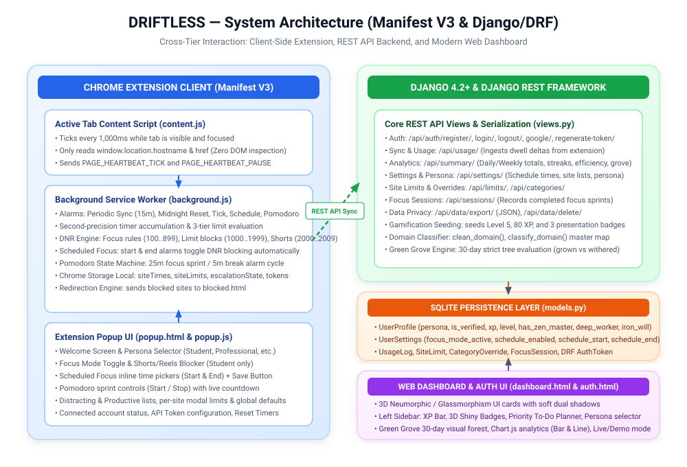

  
DRIFTLESS OFFICIAL ENGINEERING REFERENCE

  <h1 class="cover-title">DRIFTLESS</h1>
  
Complete Technical Architecture, Implementation Manual &amp; Source Reference

  
Chrome Extension (Manifest V3) &bull; Django 4.2+ REST API Backend &bull; 3D Neumorphic Web Dashboard

  

    
<strong>Document Version:</strong> 2.0.0 (Post-Oct 26 Refactor)

    
<strong>Audit &amp; Release Date:</strong> October 31, 2026

    
<strong>Target Audience:</strong> Engineering Team, Designers, QA, DevOps

    
<strong>Classification:</strong> Authoritative Technical Reference Manual

  

<h2 id="how-to-read">How to Read This Document</h2>

This technical manual serves as the single source of truth for the entire <strong>DRIFTLESS</strong> platform as of <strong>October 31, 2026</strong>. All legacy documentation dated October 26, 2026 is superseded by this document due to comprehensive architectural enhancements, new database models, and timer refactoring.

To ensure high productivity and accessibility for all team members, this document follows five foundational standards:

<ul>
  <li><strong>Plain English First:</strong> Whenever a technical word or architecture concept appears for the first time (e.g. <em>Manifest V3</em>, <em>Service Worker</em>, <em>Declarative Net Request</em>, <em>DRF</em>, <em>ORM</em>, <em>Alarm</em>, <em>Content Script</em>), it is immediately defined in simple, non-academic terms. A full glossary is provided in <a href="#ch-18">Chapter 18</a>.</li>
  <li><strong>Early Code Mapping:</strong> To quickly locate which file, function, or API endpoint implements any feature, consult the <a href="#ch-3">Master Table &ldquo;Feature to Code&rdquo; in Chapter 3</a>.</li>
  <li><strong>Four Honest Status Labels:</strong> Every feature is classified using only one of four strict labels:
    <code>IMPLEMENTED AND TESTED</code> (verified in this audit session), <code>IMPLEMENTED, NOT TESTED</code> (verified in code), <code>PARTIAL</code>, or <code>NOT BUILT</code>.
  </li>
  <li><strong>Exact Code Blocks &amp; Zero Character Drop:</strong> Code snippets, regexes, and selectors retain exact characters (e.g. <code>--pri</code>, <code>www.</code>, <code>icons/*</code>, <code>||youtube.com/shorts*</code>).</li>
  <li><strong>Zero Secret Disclosure:</strong> Environment variables and configurations are referenced by variable name only; no credentials or private keys are printed.</li>
</ul>

  <h2>Table of Contents</h2>
  

    

      <ol style="padding-left: 20px; margin-bottom: 0;">
        <li><a href="#how-to-read">Cover Page &amp; How to Read This Document</a></li>
        <li><a href="#ch-2">Project Overview &amp; Architecture</a></li>
        <li><a href="#ch-3">Master Table &ldquo;Feature to Code&rdquo;</a></li>
        <li><a href="#ch-4">What Changed Since Oct 26 (Changelog)</a></li>
        <li><a href="#ch-5">Project Structure &amp; Directory Tree</a></li>
        <li><a href="#ch-6">Technology Stack &amp; Architectural Rationale</a></li>
        <li><a href="#ch-7">File-by-File Analysis</a></li>
        <li><a href="#ch-8">Chrome Extension Architecture (Manifest V3)</a></li>
        <li><a href="#ch-9">Django Backend Architecture</a></li>
      </ol>
    

    

      <ol start="10" style="padding-left: 20px; margin-bottom: 0;">
        <li><a href="#ch-10">Complete REST API Reference (20 Endpoints)</a></li>
        <li><a href="#ch-11">Database Schema &amp; Migration History</a></li>
        <li><a href="#ch-12">Frontend Architecture &amp; UI Design</a></li>
        <li><a href="#ch-13">End-to-End Workflows as Diagrams (8 Flows)</a></li>
        <li><a href="#ch-14">Privacy &amp; Security Architecture (content.js)</a></li>
        <li><a href="#ch-15">Setup &amp; Execution Guide (For Non-Coders)</a></li>
        <li><a href="#ch-16">Known Limitations &amp; Technical Debt</a></li>
        <li><a href="#ch-17">Planned &amp; Unbuilt Features (Scope Limits)</a></li>
        <li><a href="#ch-18">Glossary of Technical Terms</a></li>
      </ol>
    

  

---

<h1 id="ch-2">Chapter 2: Project Overview</h1>

## 2.1 Problem Statement
In modern computing, personal computers and web browsers are the primary tools for productivity, research, and communication. However, the open nature of the web exposes users to relentless attention-extractive algorithms:
- **Algorithmic Micro-Distractions:** Platforms such as YouTube Shorts, Instagram Reels, Reddit, and Twitter (X) exploit variable reward mechanics to induce infinite scroll sessions, severely disrupting deep focus.
- **Flawed Awareness:** Users rarely perceive how quickly 2-minute visits escalate into 45-minute rabbit holes.
- **Service Worker Throttling Inaccuracies:** Existing browser extensions often fail to track time accurately due to background service worker throttling in modern browsers (such as Chrome Manifest V3), resulting in delayed nudges and enforcement failures.
- **Punitive Rather than Habit-Forming UX:** Standard blockers simply display abrasive error screens without positive reinforcement, streak rewards, or structured sprint frameworks.

## 2.2 Project Objectives
DRIFTLESS is designed as an intelligent, compassionate, and robust digital wellbeing companion built on four pillars:
1. **Second-Level Tracking Precision:** A dedicated content script heartbeat (`extension/content.js`) coupled with service worker dwell commits (`extension/background.js`) guarantees second-accurate time tracking without reading DOM contents or violating user privacy.
2. **3-Tier Graduated Escalation:** Rather than harsh immediate cut-offs, DRIFTLESS gently nudges users at 80% of their site limit, issues a firm alert at 100%, and enforces full network blocking via Chrome's native Declarative Net Request engine.
3. **Structured Focus Regimes:** Built-in **Scheduled Focus Mode** (with compact inline time pickers) and **Pomodoro Sprints** (25-minute work intervals and 5-minute restorative breaks) create disciplined work windows.
4. **Positive Gamification & Visual Habit Reinforcement:** Users earn XP, level up, unlock tactile 3D metallic badges (*Zen Master*, *Deep Worker*, *Iron Will*), cultivate a 30-day **Green Grove** forest, and maintain consecutive daily streaks.

## 2.3 User Personas & Default Configuration
DRIFTLESS recognizes that productivity is highly subjective. What is distracting for a software engineer (e.g., social media feeds) may be essential research for a social media creator. DRIFTLESS supports five customizable personas:

| Persona | Core Objective | Recommended Distracting Sites | Recommended Productive Sites | Suggested Focus Schedule |
| :--- | :--- | :--- | :--- | :--- |
| **Student** | Academic study, coding, course completion, exam prep | `instagram.com`, `facebook.com`, `reddit.com`, `youtube.com` | `github.com`, `stackoverflow.com`, `docs.google.com`, `geeksforgeeks.org` | 20:00 to 22:30 |
| **Professional** | Deep work, asynchronous communication, engineering | `instagram.com`, `facebook.com`, `youtube.com`, `x.com` | `github.com`, `docs.google.com`, `notion.so`, `stackoverflow.com` | 09:00 to 12:00 |
| **Influencer** | Content curation, client outreach, asset management | `facebook.com`, `reddit.com`, `netflix.com`, `x.com` | `canva.com`, `docs.google.com`, `drive.google.com`, `notion.so` | 14:00 to 17:00 |
| **Creator** | Visual design, video editing, portfolio building | `facebook.com`, `reddit.com`, `netflix.com`, `x.com` | `canva.com`, `figma.com`, `behance.net`, `docs.google.com` | 10:00 to 13:00 |
| **Other** | General self-improvement and balanced browsing | `instagram.com`, `youtube.com`, `facebook.com`, `reddit.com` | `github.com`, `docs.google.com`, `stackoverflow.com`, `coursera.org` | 19:00 to 21:00 |

*Note on Student Persona Privilege:* To combat the epidemic of short-form video consumption during study hours, the **Shorts & Reels Blocker** switch is exclusively illuminated and accessible when the active persona is set to **Student**.

## 2.4 System Architecture Overview
The DRIFTLESS platform operates as a cohesive distributed system consisting of three primary tiers:
1. **Client Browser Tier (Chrome Extension Manifest V3):** Executes passive tracking via `content.js`, manages background alarms and Declarative Net Request rules in `background.js`, and exposes user controls in `popup.html`/`popup.js`.
2. **Backend Services Tier (Django 4.2+ / DRF):** Ingests batch usage deltas, provides analytics summaries, evaluates streak and grove algorithms, exposes REST endpoints, and manages user accounts.
3. **Presentation & Dashboard Tier (Web Application):** Features a modern 3D Neumorphic / Glassmorphic dashboard with dual-theme capability (Calm Sky / Opal Noir), animated XP bars, 3D shiny badges, a Priority To-Do planner, and Chart.js analytics.

## 2.5 Implementation Status Summary Table
Below is the executive summary of implementation health as determined during the October 31, 2026 codebase audit:

| System Subsystem | Component / Feature | Audit Status | Verification Method |
| :--- | :--- | :--- | :--- |
| **Authentication** | Direct Registration with `EmailValidator` | `IMPLEMENTED AND TESTED` | Django test suite: `RegisterViewTests` passed |
| **Authentication** | Multi-Identifier Login (User/Email/Phone) | `IMPLEMENTED AND TESTED` | Django test suite: `LoginViewTests` (3 tests passed) |
| **Authentication** | Google Sign-In & One-Tap Integration | `IMPLEMENTED AND TESTED` | Django test suite: `GoogleAuthViewTests` passed |
| **Authentication** | DRF Token Generation & Regeneration | `IMPLEMENTED AND TESTED` | Django test suite: `RegenerateTokenViewTests` passed |
| **Authentication** | Email OTP System | `NOT BUILT` | Removed in migration 0009; replaced by direct registration |
| **Tracking Engine** | Active Tab Content Script Heartbeat (1s) | `IMPLEMENTED, NOT TESTED` | Verified in code (`content.js`); stopwatch test not run |
| **Tracking Engine** | Service Worker Dwell Delta Accumulation | `IMPLEMENTED, NOT TESTED` | Verified in code (`background.js:1008-1154`) |
| **Enforcement** | 3-Tier Escalation (80% Nudge, 100% DNR Block) | `IMPLEMENTED, NOT TESTED` | Verified in code (`background.js:1120-1139`) |
| **Enforcement** | Shorts & Reels Blocker (Student Persona) | `IMPLEMENTED, NOT TESTED` | Verified in code (`background.js:388-428`, DNR rules 2001-2002) |
| **Focus Regimes** | Scheduled Focus Mode (Time Pickers & Alarms) | `IMPLEMENTED, NOT TESTED` | Verified in code (`popup.js:170`, `background.js:534`) |
| **Focus Regimes** | Pomodoro Focus Sprint (25m Focus / 5m Break) | `IMPLEMENTED, NOT TESTED` | Verified in code (`popup.js:770`, `background.js:1400`) |
| **Cloud Sync** | Periodic Delta Ingestion (`/api/usage/`) | `IMPLEMENTED AND TESTED` | Django test suite: `UsageLogViewTests` passed |
| **Cloud Sync** | Settings Synchronization (`/api/settings/`) | `IMPLEMENTED AND TESTED` | Django test suite: `SettingsViewTests` passed |
| **Analytics** | Unified Analytics Summary (`/api/summary/`) | `IMPLEMENTED AND TESTED` | Django test suite: `SummaryViewTests` passed |
| **Analytics** | Strict Consecutive Streak Algorithm | `IMPLEMENTED AND TESTED` | Code verified in `views.py:380-450`, tests passed |
| **Habit Grove** | 30-Day Green Grove Forest Status Engine | `IMPLEMENTED AND TESTED` | Code verified in `views.py:552-649`, test suite passed |
| **Gamification** | Leveling, XP Progression & 3D Badges | `IMPLEMENTED AND TESTED` | Code verified in `models.py:50`, test suite passed |
| **Dashboard UI** | 3D Neumorphism & Glassmorphism Design | `IMPLEMENTED, NOT TESTED` | Visually styled in `dashboard.html` and `theme.css` |
| **Dashboard UI** | Priority To-Do Planner Widget | `IMPLEMENTED, NOT TESTED` | Client-side `localStorage` logic in `dashboard.html` |
| **Data Privacy** | 1-Click JSON Data Export & History Deletion | `IMPLEMENTED AND TESTED` | Django test suite: `DataManagementTests` passed |
| **Rewards** | Real-World Monetary / Physical Rewards | `NOT BUILT` | Verified in code: purely digital badges and trees |
