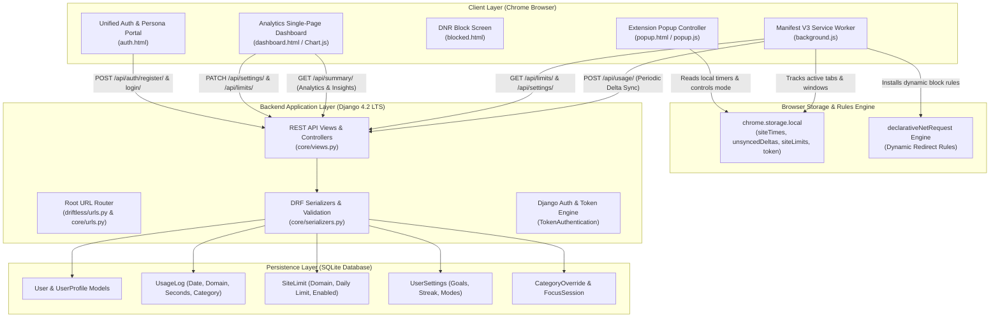

# DRIFTLESS — Project Overview & Technical Objectives

## 1. Project Identity & Purpose
- **Project Name:** DRIFTLESS — Focus & Digital Wellbeing Companion
- **Repository Root:** `c:\Users\AADI\Desktop\driftless`
- **Application Class:** Hybrid Web Application & Browser Extension (Manifest V3 + Django REST Framework)
- **Primary Mission:** Empower knowledge workers, students, professionals, and digital creators to regain control of their digital attention by pairing real-time local web dwell tracking with server-side analytics, persona-based daily limits, proactive distraction escalation, and non-punitive focus streaks.

---

## 2. Problem Statement
Modern computer users lose multiple hours each day to involuntary attention drifting—the subconscious habit of opening social media, video streaming, or infinite-scroll feeds while engaged in cognitive work. Existing screen-time software suffers from four core failures:
1. **Binary or Blurry Tracking:** Most trackers categorize domains into coarse "productive" or "unproductive" buckets without recognizing that an Instagram feed is distracting for an engineering student, yet essential research for a social media strategist or digital marketer.
2. **Passive vs. Actionable Enforcement:** Traditional tools display passive post-facto graphs after 4 hours of distraction have already passed, rather than intervening in real-time when a user reaches a threshold.
3. **Heavy Privacy Intrusion:** Conventional screen trackers log full page URLs, window titles, keystrokes, and tab screenshots, creating major data liabilities and personal privacy concerns.
4. **All-or-Nothing Blocking:** Hard website blockers trigger frustration and bypass habits. Users disable them within hours because they lack graceful escalation stages or emergency work sprints.

---

## 3. Main Objectives
- **Zero-Friction Passive Dwell Tracking:** Measure exact active seconds spent on browser tabs using Chrome Manifest V3 APIs without background CPU churn, skipping background audio, idle states, or minimized windows.
- **Privacy-by-Design Architecture:** Restrict collected metrics strictly to bare domain names (`domain.com`) and accumulated time intervals (`seconds`), never saving paths, query strings, document titles, page content, or keystrokes.
- **Three-Tier Escalation Model:**
  - *Tier 1 (80% Limit):* Non-intrusive gentle Chrome system notification nudge.
  - *Tier 2 (100% Limit):* High-priority warning alert signaling that the user's daily streak is at risk, initiating a 5-minute countdown grace period.
  - *Tier 3 (100% + 5m Grace Period):* Automatic dynamic network redirect via `declarativeNetRequest` to an uplifting, actionable `blocked.html` splash screen.
- **Persona-Driven Productivity Engine:** Support distinct operational presets (Student, Professional, Influencer, Creator, Other) that reconfigure default limits and reclassify domains (e.g., classifying `instagram.com` as Productive work for Influencers, while classifying `github.com` and `.edu` domains as Productive for Students).
- **Dual Visual Theme System:** Implement synchronized Light ("Calm Sky") and Dark ("Opal Noir") design tokens across the web dashboard, extension popup, and blocked screen without flash-of-unthemed-content (FOUC).
- **Self-Sovereign Data Controls:** Provide 1-click JSON full archive export and immediate irreversible browsing record purge endpoints.

---

## 4. Intended Users & Personas

| Persona | Primary Focus | Default Productive Sites | Typical Limits Applied |
| :--- | :--- | :--- | :--- |
| **Student** | Academic study, coding, homework | `.edu`, `github.com`, `leetcode.com`, `docs.google.com`, `notion.so` | Instagram: 30m, YouTube: 45m, Reddit: 20m, Netflix: 40m |
| **Professional** | Software engineering, collaboration, research | `github.com`, `stackoverflow.com`, `slack.com`, `jira.atlassian.com`, `linkedin.com` | Twitter/X: 20m, Instagram: 15m, YouTube: 30m, Reddit: 15m |
| **Influencer** | Content creation, community engagement | `instagram.com`, `youtube.com`, `tiktok.com`, `threads.net`, `canva.com` | Netflix: 30m, Twitch: 25m, Reddit: 20m |
| **Creator** | Video production, digital asset design, publishing | `figma.com`, `youtube.com`, `unsplash.com`, `notion.so` | Instagram: 45m, YouTube: 60m, Reddit: 20m, Netflix: 30m |
| **Other / Custom** | General balanced browsing | Default master map classification | Configurable via dashboard settings and extension popup |

---

## 5. Overall Application Architecture

---

## 6. Implementation Status Matrix

| Major Component | Specific Feature | Implementation Status | Verification Status | Notes |
| :--- | :--- | :--- | :--- | :--- |
| **Authentication** | Username / Email / Phone Multi-Login | Fully Implemented | **PASS** | Validated via unit tests and live session generation. |
| **Authentication** | Persona Selection on Sign-Up | Fully Implemented | **PASS** | Auto-populates initial `SiteLimit` entries via `apply_persona_defaults`. |
| **Authentication** | DRF Token Regeneration | Fully Implemented | **PASS** | Invalidate old token and issues a fresh hex key. |
| **Tracking Engine** | Active Tab & Dwell Accumulation | Fully Implemented | **PASS** | Runs in `background.js`; pauses on window blur and idle state. |
| **Tracking Engine** | Idle Inactivity Filtering | Fully Implemented | **PASS** | `chrome.idle.setDetectionInterval(60)` suppresses idle time. |
| **Escalation Engine**| 80% Nudge Notification | Fully Implemented | **PASS** | Triggers Chrome system notification on 80% limit reach. |
| **Escalation Engine**| 100% Streak Alert | Fully Implemented | **PASS** | Warning notification flag sets `streakAtRisk=true`. |
| **Escalation Engine**| 5m Grace Period & DNR Blocking | Fully Implemented | **PASS** | Dynamic DNR redirect rule points target domain to `blocked.html`. |
| **Sync Engine** | Periodic 60s Delta Sync | Fully Implemented | **PASS** | Pushes `unsyncedDeltas` array to `/api/usage/` via `chrome.alarms`. |
| **Sync Engine** | Midnight Local Reset | Fully Implemented | **PASS** | Flushes remaining time and resets daily local counters at 00:00. |
| **Analytics Engine**| Daily & 7-Day Usage Aggregation | Fully Implemented | **PASS** | Summarizes productive, social, entertainment, and other seconds. |
| **Analytics Engine**| Focus Efficiency Metric | Fully Implemented | **PASS** | Formula: `Productive / (Productive + Social + Entertainment) * 100`. |
| **Analytics Engine**| Strict Streak Calculation | Fully Implemented | **PASS** | Walks backward daily; breaks streak if any domain exceeded limit. |
| **Focus Blocks** | 25, 45, 60m Focus Sprints | Fully Implemented | **PASS** | DNR rules block distracting sites; logs to `FocusSession`. |
| **Theme System** | Calm Sky & Opal Noir Dual Theme | Fully Implemented | **PASS** | CSS variables in `theme.css`, `data-theme` attribute, zero FOUC. |
| **Data Privacy** | JSON Data Export & Erasure | Fully Implemented | **PASS** | `/api/data/export/` and `/api/data/delete/` functional. |

---

## 7. Known Limitations & Edge Cases
1. **Service Worker Suspension in Manifest V3:** Under Chrome's MV3 lifecycle rules, background service workers suspend after ~30 seconds of inactivity. Driftless mitigates this by committing timestamps on tab focus change, tab update, window blur, and firing `chrome.alarms` every 60 seconds to ensure timely wakeups.
2. **Tab Dwell Precision across Restarts:** If the browser process is killed abruptly via task manager without triggering `windows.onFocusChanged` or `tabs.onActivated`, time spent during that specific ongoing interval up to the last 60s flush may not be credited.
3. **Popup / Dashboard Independent Themes:** Both the extension popup and web dashboard respect the user's preferred theme key (`driftless-theme`), but since they execute in distinct DOM sandbox windows, changing the theme in one interface updates `localStorage` immediately, requiring a refresh or toggle click in the other.
4. **DeclarativeNetRequest Rule Limits:** Chrome enforces a quota of 5,000 dynamic rules per extension. Driftless consumes 1 rule per active focus block or exceeded site limit (typically < 20 rules), well within browser quotas.
