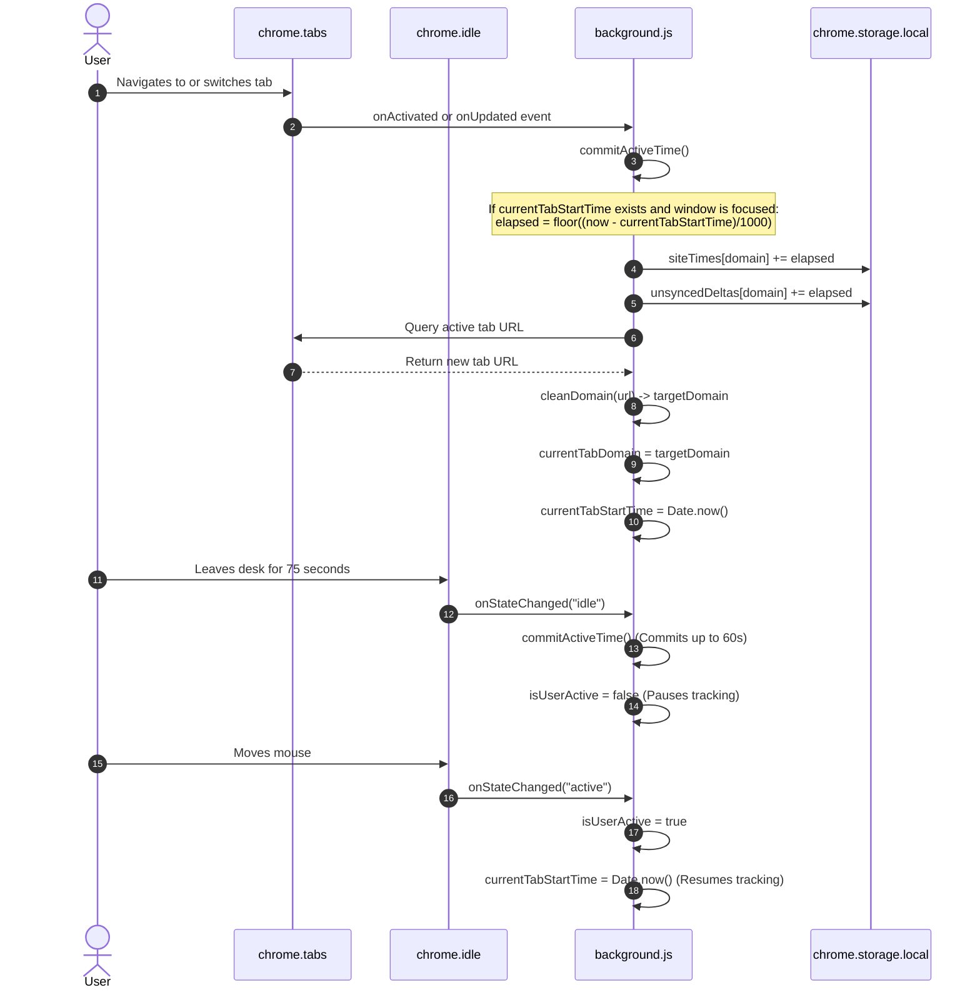
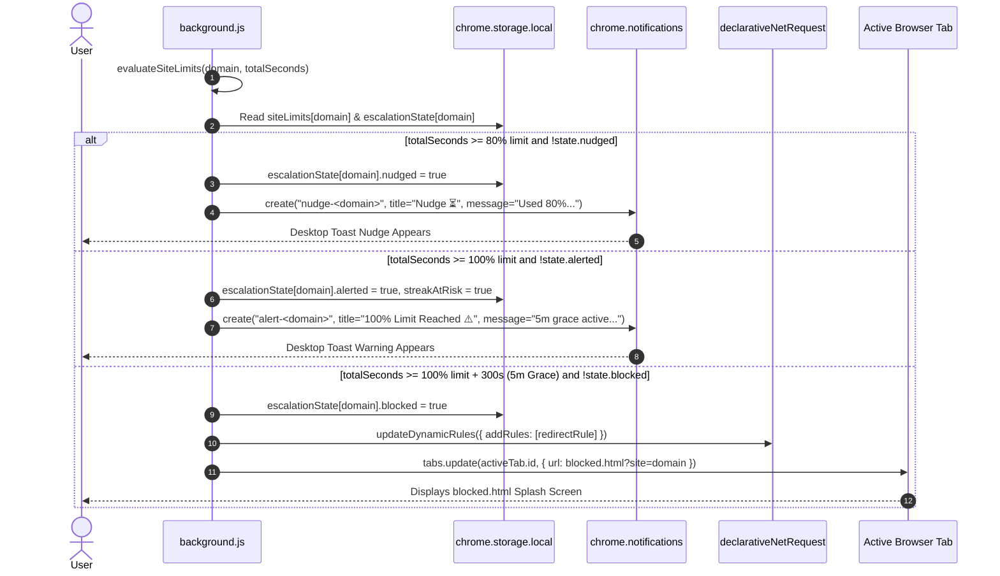
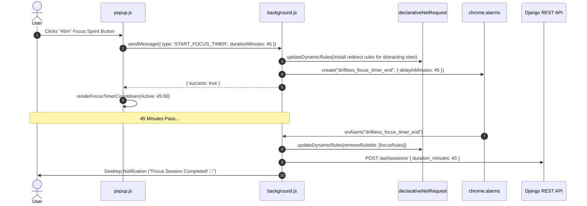
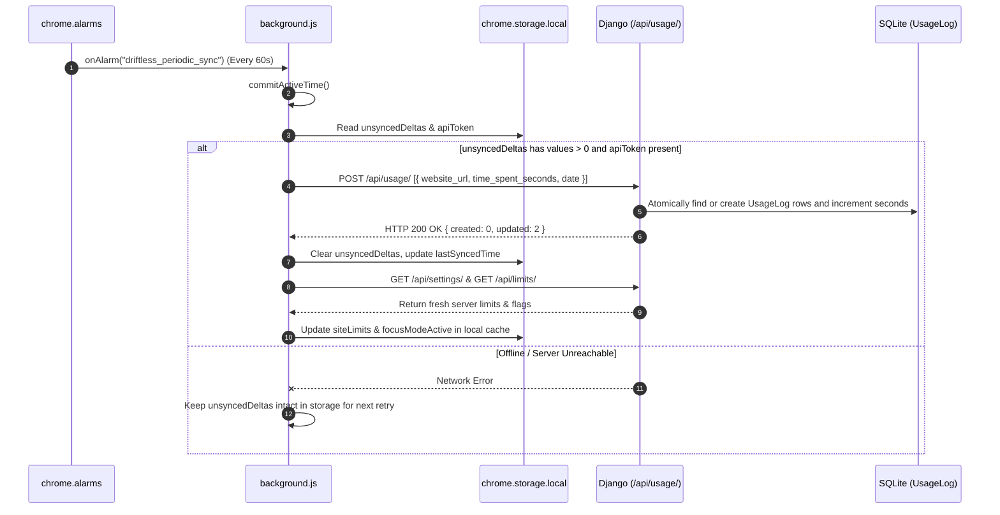

# DRIFTLESS — End-to-End System Architecture & Workflows

## 1. System Architecture Map

```mermaid
graph TB
    subgraph BrowserClient["User Browser Runtime (Google Chrome)"]
        subgraph ExtensionRuntime["Driftless Extension (Manifest V3)"]
            POPUP["Popup Controller<br/>(popup.html / popup.js)"]
            BG["Background Service Worker<br/>(background.js)"]
            BLOCKED_PAGE["Blocked Landing Page<br/>(blocked.html)"]
        end

        subgraph ChromeAPIs["Native Chrome APIs"]
            API_TABS["chrome.tabs<br/>(URL & switch events)"]
            API_WINDOWS["chrome.windows<br/>(Focus state)"]
            API_IDLE["chrome.idle<br/>(60s inactivity)"]
            API_NOTIF["chrome.notifications<br/>(Nudges & alerts)"]
            API_ALARMS["chrome.alarms<br/>(Periodic sync & midnight)"]
            API_STORAGE["chrome.storage.local<br/>(siteTimes & unsyncedDeltas)"]
            API_DNR["declarativeNetRequest<br/>(Dynamic redirect rules)"]
        end

        subgraph WebClient["Web Dashboard Application"]
            AUTH_VIEW["Auth & Persona Portal<br/>(auth.html)"]
            DASH_VIEW["Analytics Dashboard<br/>(dashboard.html)"]
            CHART_ENGINE["Chart.js 4.4 Engine<br/>(Canvas visualization)"]
        end
    end

    subgraph BackendServer["Django 4.2 LTS Application Server (port 8000)"]
        MIDDLEWARE["Middleware Stack<br/>(CORS, WhiteNoise, Session)"]
        ROUTER["URL Dispatcher<br/>(driftless/urls.py & core/urls.py)"]
        
        subgraph DRFControllers["Django REST Framework Views"]
            AUTH_CTRL["Auth Controller<br/>(/api/auth/*)"]
            USAGE_CTRL["Usage Ingestion<br/>(/api/usage/)"]
            SUMMARY_CTRL["Analytics Engine<br/>(/api/summary/)"]
            LIMITS_CTRL["Limits Controller<br/>(/api/limits/)"]
            SETTINGS_CTRL["Settings Controller<br/>(/api/settings/)"]
            CATEGORY_CTRL["Category Controller<br/>(/api/categories/)"]
            PRIVACY_CTRL["Data Sovereignty<br/>(/api/data/*)"]
        end

        ORM["Django ORM Layer"]
    end

    subgraph Database["Persistence Layer (SQLite)"]
        SQLITE_DB[("db.sqlite3<br/>Tables: User, UserProfile,<br/>UserSettings, UsageLog,<br/>SiteLimit, CategoryOverride,<br/>FocusSession, authtoken_token")]
    end

    %% Extension Internal Wiring
    BG --> API_TABS
    BG --> API_WINDOWS
    BG --> API_IDLE
    BG --> API_NOTIF
    BG --> API_ALARMS
    BG --> API_STORAGE
    BG --> API_DNR
    POPUP --> API_STORAGE
    POPUP -- "chrome.runtime.sendMessage" --> BG
    API_DNR -- "Redirects violation" --> BLOCKED_PAGE

    %% Extension to Backend
    BG -- "POST /api/usage/ (Bearer Token)" --> MIDDLEWARE
    BG -- "GET /api/limits/ & /api/settings/" --> MIDDLEWARE
    POPUP -- "PATCH /api/settings/ & /api/limits/" --> MIDDLEWARE

    %% Web Frontend to Backend
    AUTH_VIEW -- "POST /api/auth/login/ & register/" --> MIDDLEWARE
    DASH_VIEW -- "GET /api/summary/" --> MIDDLEWARE
    DASH_VIEW -- "PATCH /api/settings/ & /api/limits/" --> MIDDLEWARE
    DASH_VIEW --> CHART_ENGINE

    %% Backend Routing & Execution
    MIDDLEWARE --> ROUTER
    ROUTER --> AUTH_CTRL
    ROUTER --> USAGE_CTRL
    ROUTER --> SUMMARY_CTRL
    ROUTER --> LIMITS_CTRL
    ROUTER --> SETTINGS_CTRL
    ROUTER --> CATEGORY_CTRL
    ROUTER --> PRIVACY_CTRL

    AUTH_CTRL --> ORM
    USAGE_CTRL --> ORM
    SUMMARY_CTRL --> ORM
    LIMITS_CTRL --> ORM
    SETTINGS_CTRL --> ORM
    CATEGORY_CTRL --> ORM
    PRIVACY_CTRL --> ORM

    ORM --> SQLITE_DB
```

---

## 2. Core Workflow Diagrams

### 2.1. Website Time Tracking Workflow

---

### 2.2. Threshold Notifications & 3-Tier Escalation Workflow

---

### 2.3. Focus Mode Activation & Network Blocking Workflow

---

### 2.4. Usage Data Synchronization Workflow

